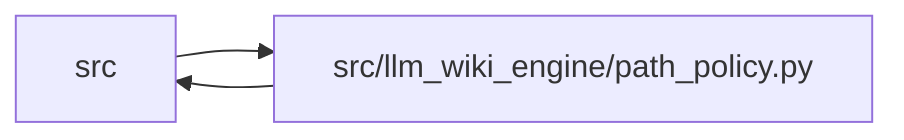

# path_policy Module

**Path:** `src/llm_wiki_engine/path_policy.py`

## Description

Workspace path policy: the default wiki directory, excluded directories,
agent worktrees and validation of wiki and source roots.

``llm_wiki_cli.config`` re-exports every name for existing callers.

## Imports

| Source | Symbols |
|--------|---------|
| `.filesystem_guard` | `WindowsSecurityGuardError`, `windows_current_user_sid`, `windows_path_owner_sid` |
| `.io` | `first_unsafe_path_component` |
| `__future__` | `annotations` |
| `collections.abc` | `Callable` |
| `llm_wiki_engine.host` | `current_host` |
| `os` | `os` |
| `pathlib` | `Path` |
| `sys` | `sys` |
| `warnings` | `warnings` |

## Local dependency map

<!-- Auto-generated local dependency summary. Do not edit by hand. -->

> Module-level dependencies exceed the generated-diagram limits, so the diagram and table below group them by top-level package. Counts report the number of module neighbors in each package.

### Internal neighbors

| Direction | Module |
|---|---|
| Inbound | `src` (27) |
| Outbound | `src` (3) |

> All 30 module neighbor(s) are summarized by package because the module-level view exceeds the 12-node limit.

## Classes

| Class | Line | Bases | Description |
|-------|------|-------|-------------|
| [PathValidationError](../entities/PathValidationError.md) | 90 | `ValueError` | Raised when a user-provided path escapes the project root. |

## Functions

| Function | Signature | Decorators | Description |
|----------|-----------|------------|-------------|
| `_normalized_rel_parts` | `(path: 'str \| Path') -> tuple[str, ...]` | — | — |
| `is_agent_worktree_path` | `(path: 'str \| Path') -> bool` | — | Return whether *path* is inside a generated agent worktree subtree. |
| `validate_path` | `(path: str, label: str = 'path') -> Path` | — | Ensure *path* resolves inside the current working directory. |
| `validate_source_root` | `(path: str, label: str = '--src-dir', *, allow_external: bool = False) -> Path` | — | Validate a source root according to the CLI source-read policy. |
| `validate_source_paths` | `(src_dir: str \| Path, paths: list[str] \| tuple[str, ...] \| None, label: str = '--paths') -> None` | — | Ensure requested source file paths stay inside *src_dir*. |
