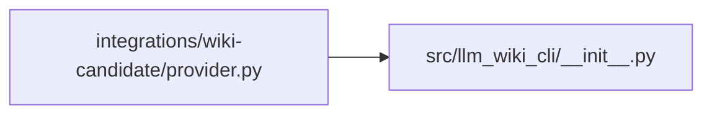

# provider Module

**Path:** `integrations/wiki-candidate/provider.py`

## Description

Install the provider packaged with the pinned action and attest its bytes.

## Imports

| Source | Symbols |
|--------|---------|
| `hashlib` | `hashlib` |
| `importlib` | `metadata` |
| `json` | `json` |
| `llm_wiki_cli` | `llm_wiki_cli` |
| `os` | `os` |
| `pathlib` | `Path` |
| `re` | `re` |
| `shutil` | `shutil` |
| `subprocess` | `subprocess` |
| `sys` | `sys` |
| `tarfile` | `tarfile` |
| `tempfile` | `tempfile` |
| `tomllib` | `tomllib` |
| `venv` | `venv` |

## Local dependency map

<!-- Auto-generated local dependency summary. Do not edit by hand. -->

### Internal neighbors

| Direction | Module |
|---|---|
| Outbound | [llm_wiki_cli___init__](../modules/llm_wiki_cli___init__.md) |

## Functions

| Function | Signature | Decorators | Description |
|----------|-----------|------------|-------------|
| `verify` | `(source: Path, receipt: Path, revision: str, repository: str) -> None` | — | — |
| `build_input` | `(provider: Path, runtime: Path) -> tuple[Path, str, str]` | — | — |
| `setup` | `() -> None` | — | — |
