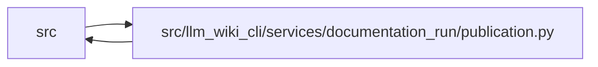

# publication Module

**Path:** `src/llm_wiki_cli/services/documentation_run/publication.py`

## Description

Supervisor-owned binding between a documentation run and mapped public prose.

## Imports

| Source | Symbols |
|--------|---------|
| `..documentation_policy` | `capture_tree_baseline`, `hash_bytes` |
| `..documentation_review` | `DocumentationReviewLedger` |
| `..filesystem_guard` | `atomic_write_private_bytes`, `ensure_guarded_directory`, `unlink_guarded_bytes` |
| `..knowledge_evidence` | `hash_json` |
| `..knowledge_governance` | `governance_lock` |
| `..publication_candidate` | `_read_tree` |
| `.contracts` | `DocumentationAgentResult`, `DocumentationIntegrityError`, `DocumentationRun`, `DocumentationTransitionError`, `RUN_CONTROL_DIR`, `_utc_now` |
| `.integrity` | `_verify_read_only_inputs`, `_verify_read_only_inputs` |
| `.workspace` | `_read_json`, `_resolve_workspace_root_argument`, `_workspace_path`, `documentation_run_path`, `load_documentation_run` |
| `__future__` | `annotations` |
| `json` | `json` |
| `os` | `os` |
| `pathlib` | `Path` |
| `tempfile` | `TemporaryDirectory` |
| `typing` | `Any`, `Mapping` |
| `unicodedata` | `unicodedata` |

## Local dependency map

<!-- Auto-generated local dependency summary. Do not edit by hand. -->

> Module-level dependencies exceed the generated-diagram limits, so the diagram and table below group them by top-level package. Counts report the number of module neighbors in each package.

### Internal neighbors

| Direction | Module |
|---|---|
| Inbound | `src` (7) |
| Outbound | `src` (9) |

> All 15 module neighbor(s) are summarized by package because the module-level view exceeds the 12-node limit.

## Functions

| Function | Signature | Decorators | Description |
|----------|-----------|------------|-------------|
| `_hashes` | `(files: Mapping[str, bytes]) -> dict[str, str]` | — | — |
| `_binding` | `(root: Path, run: DocumentationRun) -> dict[str, Any]` | — | — |
| `_initial_hashes` | `(binding: Mapping[str, Any]) -> dict[str, str]` | — | — |
| `_documents` | `(root: Path, run: DocumentationRun) -> dict[str, bytes]` | — | — |
| `bind_publication_workspace` | `(workspace: str \| Path, *, binding: Mapping[str, Any], documents: Mapping[str, bytes]) -> None` | — | Seed an undispatched external workspace with the explicitly mapped originals. |
| `_stage_publication_documents` | `(staging: Path, documents: Mapping[str, bytes]) -> None` | — | Validate, copy and re-read each declared Markdown file before committing the binding. |
| `_bind_publication` | `(root: Path, binding: Mapping[str, Any], documents: Mapping[str, bytes]) -> None` | — | — |
| `publication_packet` | `(root: Path, run: DocumentationRun, wiki_tree_hash: str) -> dict[str, Any]` | — | Check the last accepted workspace before another packet can redefine its baseline. |
| `protected_stage_hash` | `(root: Path, stage: str, event: Path) -> str` | — | Cover supervisor controls, site outputs and unexpected workspace files. |
| `reconcile_publication` | `(root: Path, run: DocumentationRun, result: DocumentationAgentResult, actor: str \| None, actual_wiki_changes: list[str]) -> dict[str, Any]` | — | Reconcile the author's precise write scope and the reviewer's read-only scope. |
| `record_publication_evidence` | `(root: Path, run: DocumentationRun, stage: str, record: Mapping[str, Any], wiki_tree_hash: str) -> None` | — | — |
| `reviewed_publication` | `(root: Path, run: DocumentationRun, *, approved: bool) -> tuple[dict[str, Any], dict[str, bytes]]` | — | Read the same accepted bytes and independent packet/result hashes that were reconciled. |
| `collect_reviewed_publication_edits` | `(workspace: str \| Path, *, binding: Mapping[str, Any]) -> tuple[dict[str, Any], dict[str, bytes]]` | — | — |
