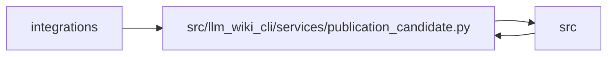

# publication_candidate Module

**Path:** `src/llm_wiki_cli/services/publication_candidate.py`

## Description

Portable, review-bound GitHub wiki candidates without remote mutation.

## Imports

| Source | Symbols |
|--------|---------|
| `..` | `__version__` |
| `.filesystem_guard` | `atomic_write_private_bytes`, `ensure_guarded_directory` |
| `.knowledge_evidence` | `hash_json`, `sha256_bytes` |
| `.knowledge_storage_io` | `StorageReadSession`, `_absolute_path` |
| `.publication_config` | `load_publication_config`, `publication_control_overlap`, `publication_input_controls`, `publication_path` |
| `.publication_contracts` | `_json_tree`, `validate_publication_basis`, `validate_publication_report` |
| `.publication_impact` | `capture_publication_basis`, `compare_publication_impact`, `project_publication_targets`, `project_publication_targets`, `publication_target_observation` |
| `.publication_links` | `check_github_wiki`, `prepare_wiki_markdown`, `check_github_wiki` |
| `.publication_snapshot` | `assert_bootstrap_output_excluded` |
| `.validation` | `portable_path_key`, `require_portable_relative_path` |
| `__future__` | `annotations` |
| `copy` | `deepcopy` |
| `importlib` | `metadata` |
| `json` | `json` |
| `pathlib` | `Path` |
| `re` | `re` |
| `stat` | `stat` |
| `typing` | `Any`, `Mapping` |

## Local dependency map

<!-- Auto-generated local dependency summary. Do not edit by hand. -->

> Module-level dependencies exceed the generated-diagram limits, so the diagram and table below group them by top-level package. Counts report the number of module neighbors in each package.

### Internal neighbors

| Direction | Module |
|---|---|
| Inbound | `integrations` (1) |
| Inbound | `src` (2) |
| Outbound | `src` (10) |

> All 13 module neighbor(s) are summarized by package because the module-level view exceeds the 12-node limit.

## Functions

| Function | Signature | Decorators | Description |
|----------|-----------|------------|-------------|
| `_portable` | `(value)` | — | — |
| `_sealed` | `(value, key)` | — | — |
| `_hashes` | `(files)` | — | — |
| `_same` | `(left: Path, right: Path) -> bool` | — | — |
| `_candidate_path` | `(root, value)` | — | — |
| `_within` | `(path: Path, root: Path) -> bool` | — | — |
| `_target_path` | `(root, value)` | — | — |
| `_tree_paths` | `(root: Path, *, target_snapshot: bool)` | — | — |
| `_read_tree` | `(root: Path, *, target_snapshot: bool = False)` | — | — |
| `_provider` | `()` | — | — |
| `_check_hash` | `(value)` | — | — |
| `_hash_map` | `(value)` | — | — |
| `_proposal` | `(receipt)` | — | — |
| `_validate_review` | `(value)` | — | — |
| `validate_publication_receipt` | `(receipt: Mapping[str, Any]) -> None` | — | Validate a complete receipt without trusting its readiness assertions. |
| `review_publication_candidate` | `(receipt: Mapping[str, Any], *, reviewer: str, reason: str) -> dict[str, Any]` | — | Prepare an exact-artifact acceptance record for repository review. |
| `_output_path` | `(root, name, config, target, basis, config_path)` | — | — |
| `_prepare` | `(consumer_root, *, config_path, target_dir, baseline, reviews, previous_receipt, candidate_review, source_revision, target_revision)` | — | — |
| `export_publication_candidate` | `(consumer_root: str \| Path = '.', *, output_dir: str \| Path, config_path: str \| Path = '.llm-wiki/publication.json', target_dir: str \| Path \| None = None, baseline: Mapping[str, Any] \| None = None, reviews: Mapping[str, Any] \| None = None, previous_receipt: Mapping[str, Any] \| None = None, candidate_review: Mapping[str, Any] \| None = None, source_revision: str \| None = None, target_revision: str \| None = None) -> dict[str, Any]` | — | Render a fresh local candidate, preserving every unmanaged target file. |
| `check_publication_candidate` | `(consumer_root: str \| Path = '.', *, candidate_dir: str \| Path, receipt: Mapping[str, Any], config_path: str \| Path = '.llm-wiki/publication.json', target_dir: str \| Path \| None = None, baseline: Mapping[str, Any] \| None = None, reviews: Mapping[str, Any] \| None = None, previous_receipt: Mapping[str, Any] \| None = None, candidate_review: Mapping[str, Any] \| None = None, source_revision: str \| None = None, target_revision: str \| None = None) -> dict[str, Any]` | — | Re-render current inputs and verify exact candidate bytes without writing. |
| `_recheck_basis` | `(root, config_path, target_dir, baseline, files, receipt)` | — | — |
| `validate_candidate_tree` | `(consumer_root: str \| Path, candidate_dir: str \| Path, receipt: Mapping[str, Any]) -> None` | — | Verify the full artifact inventory before preparing a local review. |
| `validate_candidate_target` | `(consumer_root: str \| Path, target_dir: str \| Path \| None, receipt: Mapping[str, Any]) -> None` | — | Recheck the original public target before preparing an artifact review. |
