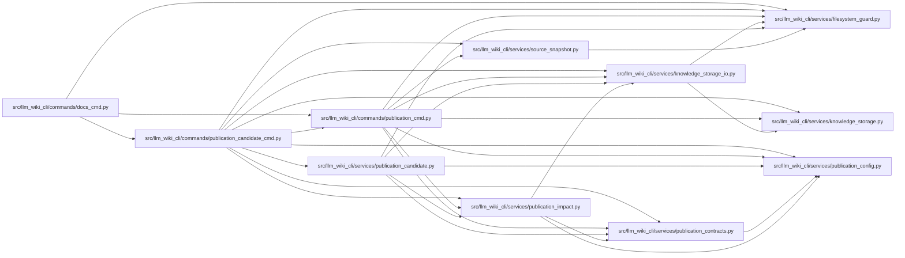

# publication_candidate_cmd Module

**Path:** `src/llm_wiki_cli/commands/publication_candidate_cmd.py`

## Description

Local GitHub wiki candidates and exact-artifact review proposals.

## Imports

| Source | Symbols |
|--------|---------|
| `.` | `publication_cmd` |
| `..services.filesystem_guard` | `atomic_write_private_bytes`, `ensure_guarded_directory` |
| `..services.knowledge_storage` | `KnowledgeStorageError` |
| `..services.knowledge_storage_io` | `StorageReadSession`, `_absolute_path` |
| `..services.publication_candidate` | `check_publication_candidate`, `export_publication_candidate`, `review_publication_candidate`, `validate_candidate_target`, `validate_candidate_tree`, `validate_publication_receipt` |
| `..services.publication_config` | `load_publication_config`, `publication_control_overlap`, `publication_input_controls` |
| `..services.publication_contracts` | `validate_publication_basis` |
| `..services.publication_impact` | `MAX_JSON_BYTES`, `read_publication_document` |
| `..services.source_snapshot` | `_is_package_marker` |
| `__future__` | `annotations` |
| `collections.abc` | `Mapping` |
| `pathlib` | `Path` |
| `sys` | `sys` |

## Local dependency map

<!-- Auto-generated local dependency summary. Do not edit by hand. -->

### Internal neighbors

| Direction | Module |
|---|---|
| Inbound | [docs_cmd](../modules/docs_cmd.md) |
| Outbound | [publication_cmd](../modules/publication_cmd.md) |
| Outbound | [filesystem_guard](../modules/filesystem_guard.md) |
| Outbound | [knowledge_storage](../modules/knowledge_storage.md) |
| Outbound | [knowledge_storage_io](../modules/knowledge_storage_io.md) |
| Outbound | [publication_candidate](../modules/publication_candidate.md) |
| Outbound | [publication_config](../modules/publication_config.md) |
| Outbound | [publication_contracts](../modules/publication_contracts.md) |
| Outbound | [publication_impact](../modules/publication_impact.md) |
| Outbound | [source_snapshot](../modules/source_snapshot.md) |

## Functions

| Function | Signature | Decorators | Description |
|----------|-----------|------------|-------------|
| `_common` | `(parser)` | — | — |
| `add_commands` | `(docs_sub)` | — | — |
| `_path` | `(args, value)` | — | — |
| `_read` | `(args, value)` | — | — |
| `_basis_files` | `(basis)` | — | — |
| `_guard_destination` | `(args, value, *, receipt = None, baseline = None)` | — | — |
| `_write` | `(args, destination, value)` | — | — |
| `run` | `(args)` | — | — |
