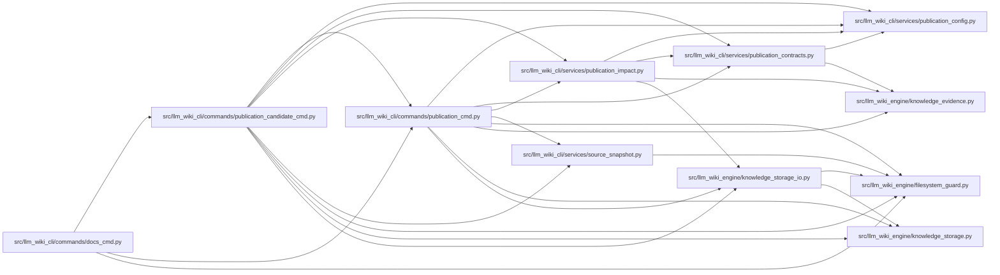

# publication_cmd Module

**Path:** `src/llm_wiki_cli/commands/publication_cmd.py`

## Description

Read-only public wiki impact and explicit review record preparation.

## Imports

| Source | Symbols |
|--------|---------|
| `..services.publication_config` | `load_publication_config`, `publication_control_overlap`, `publication_input_controls` |
| `..services.publication_contracts` | `validate_publication_basis` |
| `..services.publication_impact` | `IMPACT_SCHEMA`, `MAX_JSON_BYTES`, `capture_publication_basis`, `compare_publication_impact`, `read_publication_document`, `render_publication_impact`, `resolve_publication_finding` |
| `..services.source_snapshot` | `_is_package_marker` |
| `__future__` | `annotations` |
| `json` | `json` |
| `llm_wiki_engine.filesystem_guard` | `atomic_write_private_bytes`, `ensure_guarded_directory` |
| `llm_wiki_engine.knowledge_evidence` | `hash_json` |
| `llm_wiki_engine.knowledge_storage` | `KnowledgeStorageError` |
| `llm_wiki_engine.knowledge_storage_io` | `StorageReadSession`, `_absolute_path` |
| `os` | `sep` |
| `pathlib` | `Path` |
| `sys` | `sys` |

## Local dependency map

<!-- Auto-generated local dependency summary. Do not edit by hand. -->

### Internal neighbors

| Direction | Module |
|---|---|
| Inbound | [docs_cmd](../modules/docs_cmd.md) |
| Inbound | [publication_candidate_cmd](../modules/publication_candidate_cmd.md) |
| Outbound | [publication_config](../modules/publication_config.md) |
| Outbound | [publication_contracts](../modules/publication_contracts.md) |
| Outbound | [publication_impact](../modules/publication_impact.md) |
| Outbound | [source_snapshot](../modules/source_snapshot.md) |
| Outbound | [filesystem_guard](../modules/filesystem_guard.md) |
| Outbound | [knowledge_evidence](../modules/knowledge_evidence.md) |
| Outbound | [knowledge_storage](../modules/knowledge_storage.md) |
| Outbound | [knowledge_storage_io](../modules/knowledge_storage_io.md) |

## Functions

| Function | Signature | Decorators | Description |
|----------|-----------|------------|-------------|
| `_normalize_consumer_paths` | `(args)` | — | Translate native CLI separators without normalizing traversal or aliases. |
| `_artifact_path` | `(args, value)` | — | — |
| `_same_file` | `(left: Path, right: Path) -> bool` | — | — |
| `_inside_input_tree` | `(destination: Path, source: Path) -> bool` | — | — |
| `_declared_files` | `(config)` | — | — |
| `_document_bytes` | `(value)` | — | — |
| `_write` | `(args, value, *, expected_document = None, input_basis = None, baseline_basis = None)` | — | — |
| `_error_report` | `(message)` | — | — |
| `run` | `(args)` | — | — |
