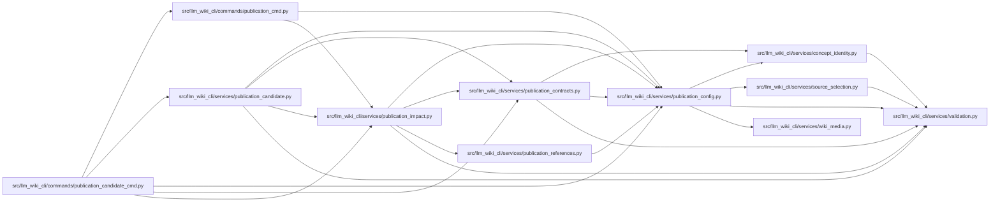

# publication_config Module

**Path:** `src/llm_wiki_cli/services/publication_config.py`

## Description

Portable consumer policy for read-only publication impact and review.

Whole-page dependencies use whole content commitments. Structural or semantic
facets require an exact native section with independently committed ownership.
Reference dependencies require an explicitly declared, non-executable provider.

## Imports

| Source | Symbols |
|--------|---------|
| `.concept_identity` | `ConceptIdentityError`, `validate_locator` |
| `.source_selection` | `SOURCE_SELECTION_PATH`, `SourceSelectionError`, `locate_exact_repository_path`, `path_is_link_or_reparse` |
| `.validation` | `portable_path_key`, `require_repository_relative_path` |
| `.wiki_media` | `MEDIA_EXTENSIONS` |
| `__future__` | `annotations` |
| `collections.abc` | `Mapping` |
| `ipaddress` | `ipaddress` |
| `json` | `json` |
| `os` | `os` |
| `pathlib` | `Path`, `PurePosixPath` |
| `re` | `re` |
| `stat` | `stat` |
| `typing` | `Any` |
| `unicodedata` | `unicodedata` |
| `urllib.parse` | `quote`, `unquote`, `urlsplit` |

## Local dependency map

<!-- Auto-generated local dependency summary. Do not edit by hand. -->

### Internal neighbors

| Direction | Module |
|---|---|
| Inbound | [publication_candidate_cmd](../modules/publication_candidate_cmd.md) |
| Inbound | [publication_cmd](../modules/publication_cmd.md) |
| Inbound | [publication_candidate](../modules/publication_candidate.md) |
| Inbound | [publication_contracts](../modules/publication_contracts.md) |
| Inbound | [publication_impact](../modules/publication_impact.md) |
| Inbound | [publication_references](../modules/publication_references.md) |
| Outbound | [concept_identity](../modules/concept_identity.md) |
| Outbound | [source_selection](../modules/source_selection.md) |
| Outbound | [validation](../modules/validation.md) |
| Outbound | [wiki_media](../modules/wiki_media.md) |

## Classes

| Class | Line | Bases | Description |
|-------|------|-------|-------------|
| [PublicationConfigError](../entities/PublicationConfigError.md) | 51 | `ValueError` | A field-specific failure in consumer-owned publication configuration. |

## Functions

| Function | Signature | Decorators | Description |
|----------|-----------|------------|-------------|
| `_object` | `(value: object, field: str, required: set[str], optional: set[str] \| None = None) -> Mapping[str, Any]` | — | — |
| `_text` | `(value: object, field: str, maximum: int = 1024) -> str` | — | — |
| `_choice` | `(value: object, field: str, choices: set[str]) -> str` | — | — |
| `_array` | `(value: object, field: str, maximum: int, *, nonempty: bool = False) -> list[Any]` | — | — |
| `_relative_path` | `(value: object, field: str) -> str` | — | — |
| `_consumer_root` | `(value: str \| Path) -> Path` | — | — |
| `_check_path` | `(root: Path \| None, path: str, field: str, spellings: dict[tuple[str, ...], tuple[str, ...]]) -> None` | — | — |
| `publication_path` | `(root: Path, relative: str) -> Path` | — | Return a confined exact-case path, including a safely absent leaf. |
| `publication_input_controls` | `(root: Path, config, config_path) -> set[Path]` | — | Reserve implicit discovery inputs, including safely absent coordinates. |
| `publication_control_overlap` | `(left: Path, right: Path) -> bool` | — | Compare protected input namespaces across portable filesystem names. |
| `_section` | `(value: object, field: str) -> str` | — | — |
| `_dependency` | `(value: object, field: str, root: Path \| None, architecture_root: str, spellings: dict[tuple[str, ...], tuple[str, ...]], reference_providers: Mapping[str, Any]) -> dict[str, Any]` | — | — |
| `_reference_providers` | `(value: object, root: Path \| None, spellings: dict[tuple[str, ...], tuple[str, ...]]) -> dict[str, dict[str, Any]]` | — | — |
| `_public_content_path` | `(value: object, field: str, *, asset: bool = False) -> str` | — | — |
| `_content_source_path` | `(path: str, content_root: str, architecture, field: str) -> None` | — | — |
| `_content_repository_url` | `(value: object) -> str` | — | — |
| `_content_profile` | `(value, root, architecture, topics, spellings)` | — | — |
| `validate_publication_config` | `(payload: Mapping[str, Any], *, consumer_root: str \| Path \| None) -> dict[str, Any]` | — | Validate detached policy; None checks imported policy without filesystem I/O. |
| `_json_object` | `(pairs: list[tuple[str, Any]]) -> dict[str, Any]` | — | — |
| `_reject_constant` | `(value: str) -> None` | — | — |
| `read_publication_json` | `(path: str \| Path, *, max_bytes: int = _MAX_CONFIG_BYTES) -> dict[str, Any]` | — | Read bounded regular JSON; callers confine its parent with publication_path. |
| `load_publication_config` | `(consumer_root: str \| Path, *, config_path: str \| Path = PUBLICATION_CONFIG_PATH) -> dict[str, Any]` | — | Load an explicit consumer's regular JSON config without following links. |
