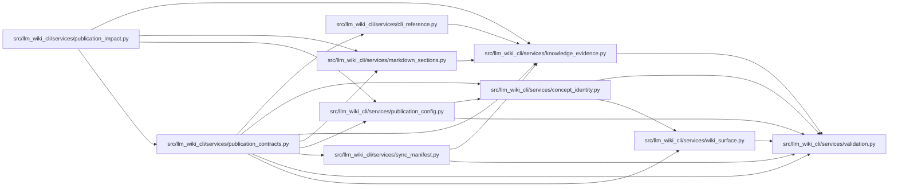

# publication_contracts Module

**Path:** `src/llm_wiki_cli/services/publication_contracts.py`

## Description

Strict portable validators for captured publication evidence and decisions.

## Imports

| Source | Symbols |
|--------|---------|
| `.cli_reference` | `validate_cli_contract` |
| `.concept_identity` | `validate_concept_uid` |
| `.knowledge_evidence` | `hash_json` |
| `.markdown_sections` | `SECTION_ORDER_DOMAIN`, `section_locator` |
| `.publication_config` | `PUBLICATION_CONFIG_SCHEMA_VERSION`, `validate_publication_config` |
| `.sync_manifest` | `ManifestPageSource` |
| `.validation` | `portable_path_key`, `require_repository_relative_path`, `require_sha256` |
| `.wiki_surface` | `PageKind`, `canonical_path`, `iter_page_kinds`, `mcp_uri` |
| `__future__` | `annotations` |
| `collections` | `Counter` |
| `collections.abc` | `Mapping` |
| `copy` | `deepcopy` |
| `math` | `math` |
| `re` | `re` |
| `typing` | `Any`, `NoReturn` |

## Local dependency map

<!-- Auto-generated local dependency summary. Do not edit by hand. -->

### Internal neighbors

| Direction | Module |
|---|---|
| Inbound | [publication_impact](../modules/publication_impact.md) |
| Outbound | [cli_reference](../modules/cli_reference.md) |
| Outbound | [concept_identity](../modules/concept_identity.md) |
| Outbound | [knowledge_evidence](../modules/knowledge_evidence.md) |
| Outbound | [markdown_sections](../modules/markdown_sections.md) |
| Outbound | [publication_config](../modules/publication_config.md) |
| Outbound | [sync_manifest](../modules/sync_manifest.md) |
| Outbound | [validation](../modules/validation.md) |
| Outbound | [wiki_surface](../modules/wiki_surface.md) |

## Classes

| Class | Line | Bases | Description |
|-------|------|-------|-------------|
| [PublicationProtocolError](../entities/PublicationProtocolError.md) | 38 | `ValueError` | An imported publication document violates its versioned contract. |

## Functions

| Function | Signature | Decorators | Description |
|----------|-----------|------------|-------------|
| `_fail` | `(field: str, message: str) -> NoReturn` | — | — |
| `_record` | `(value: object, field: str, required: set[str], optional: set[str] \| None = None) -> Mapping[str, Any]` | — | — |
| `_array` | `(value: object, field: str, maximum: int = _MAX_ITEMS) -> list[Any]` | — | — |
| `_text` | `(value: object, field: str, *, empty: bool = False, maximum: int = 4096) -> str` | — | — |
| `_integer` | `(value: object, field: str, minimum: int = 0, maximum: int = 2 ** 63 - 1) -> int` | — | — |
| `_hash` | `(value: object, field: str, *, nullable: bool = False) -> None` | — | — |
| `_path` | `(value: object, field: str) -> str` | — | — |
| `_topic_id` | `(value: object, field: str) -> str` | — | — |
| `_path_spelling` | `(path: str, field: str, seen: dict[tuple[str, ...], tuple[str, ...]]) -> None` | — | — |
| `_json_tree` | `(value: object) -> None` | — | — |
| `_seal` | `(value: Mapping[str, Any], schema: str, key: str) -> None` | — | — |
| `_source_basis` | `(value: object, field: str) -> None` | — | — |
| `_owned_hashes` | `(data: Mapping[str, Any], field: str) -> None` | — | — |
| `_preamble` | `(value: object, page: Mapping[str, Any], field: str) -> None` | — | — |
| `_sections` | `(value: object, page: Mapping[str, Any], field: str) -> None` | — | — |
| `_snapshot` | `(value: object) -> None` | — | — |
| `_target` | `(value: object, field: str, *, unevaluated: bool = False) -> None` | — | — |
| `_provider_configuration` | `(value: object, provider: str, field: str) -> Mapping[str, Any]` | — | — |
| `_references` | `(value: object, config: Mapping[str, Any]) -> None` | — | — |
| `_basis` | `(value: object) -> None` | — | — |
| `_reviews` | `(value: object) -> list[dict[str, Any]]` | — | — |
| `_dependency` | `(value: object, field: str) -> Mapping[str, Any]` | — | — |
| `_input` | `(value: object, field: str) -> None` | — | — |
| `_reasons` | `(value: object, field: str, *, coverage: bool) -> None` | — | — |
| `_report` | `(value: object) -> None` | — | — |
| `_guard` | `(callback, value: object)` | — | — |
| `validate_publication_basis` | `(value: object) -> None` | — | Require a sealed complete basis with valid portable nested commitments. |
| `validate_publication_reviews` | `(value: object) -> list[dict[str, Any]]` | — | Return detached explicit decisions, rejecting duplicates and unknown fields. |
| `validate_publication_report` | `(value: object) -> None` | — | Require a sealed impact report suitable for selecting an exact finding. |
