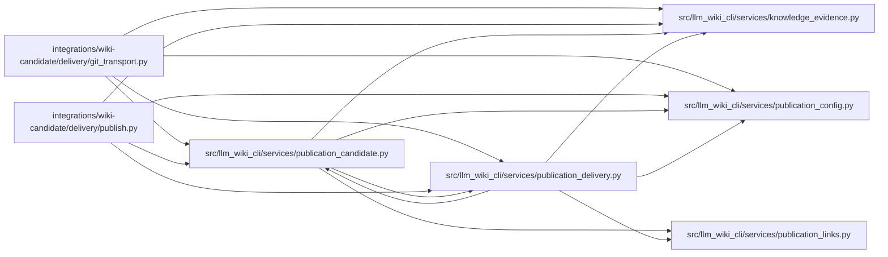

# publication_delivery Module

**Path:** `src/llm_wiki_cli/services/publication_delivery.py`

## Description

Pure validation and composition of a reviewed GitHub wiki delivery or rollback.

## Imports

| Source | Symbols |
|--------|---------|
| `.knowledge_evidence` | `canonical_json_bytes`, `hash_json`, `sha256_bytes` |
| `.publication_candidate` | `MAX_FILE_BYTES`, `MAX_FILES`, `MAX_TREE_BYTES`, `_PRIVATE`, `_REVISION`, `_VCS`, `_check_hash`, `_hash_map`, `_hashes`, `_validate_candidate_files`, `validate_publication_receipt` |
| `.publication_config` | `DELIVERY_CHECKPOINT_PATH`, `DELIVERY_CONFIG_SCHEMA_VERSION`, `publication_ref_name`, `publication_repository`, `validate_publication_config` |
| `.publication_links` | `check_github_wiki` |
| `__future__` | `annotations` |
| `collections.abc` | `Mapping` |
| `difflib` | `difflib` |
| `json` | `json` |
| `typing` | `Any` |

## Local dependency map

<!-- Auto-generated local dependency summary. Do not edit by hand. -->

### Internal neighbors

| Direction | Module |
|---|---|
| Inbound | [git_transport](../modules/git_transport.md) |
| Inbound | [publish](../modules/publish.md) |
| Inbound | [publication_candidate](../modules/publication_candidate.md) |
| Outbound | [knowledge_evidence](../modules/knowledge_evidence.md) |
| Outbound | [publication_candidate](../modules/publication_candidate.md) |
| Outbound | [publication_config](../modules/publication_config.md) |
| Outbound | [publication_links](../modules/publication_links.md) |

## Functions

| Function | Signature | Decorators | Description |
|----------|-----------|------------|-------------|
| `_revision` | `(value: object) -> str` | — | — |
| `validate_rollback_review` | `(record: Mapping[str, Any], *, rollback_id: str) -> None` | — | Validate a host-accepted review record against the live rollback proposal. |
| `review_rollback` | `(proposal: Mapping[str, Any], *, reviewer: str, reason: str) -> dict[str, str]` | — | Prepare a private review record for the consumer's normal acceptance process. |
| `_public_hashes` | `(files: Mapping[str, bytes]) -> dict[str, str]` | — | — |
| `_checkpoint_bytes` | `(checkpoint: Mapping[str, Any]) -> bytes` | — | — |
| `_validated_checkpoint` | `(raw: bytes, observed: Mapping[str, str]) -> dict[str, Any]` | — | — |
| `split_delivery_tree` | `(tree: Mapping[str, bytes]) -> tuple[dict[str, bytes], dict[str, Any] \| None]` | — | Separate the exact root checkpoint from public files and validate owned bytes. |
| `_scope` | `(policy, source_repository, target_repository, target_branch)` | — | — |
| `_match_scope` | `(checkpoint, scope)` | — | — |
| `_compose` | `(public, state)` | — | — |
| `plan_delivery` | `(receipt: Mapping[str, Any], candidate_files: Mapping[str, bytes], target_tree: Mapping[str, bytes], *, policy: Mapping[str, Any], source_repository: str, target_repository: str, target_branch: str, target_revision: str) -> tuple[dict[str, bytes], dict[str, Any] \| None]` | — | Build the exact proposed target bytes for a host-verified source/ref. |
| `_rollback_diff` | `(before, after)` | — | Retain exact file commitments plus bounded readable Markdown changes. |
| `plan_rollback` | `(current_tree: Mapping[str, bytes], historical_tree: Mapping[str, bytes], *, policy: Mapping[str, Any], source_repository: str, target_repository: str, target_branch: str, source_revision: str, target_revision: str, restore_revision: str) -> tuple[dict[str, bytes], dict[str, Any]]` | — | Propose a new target commit restoring earlier ownership and preserving manual changes. |
