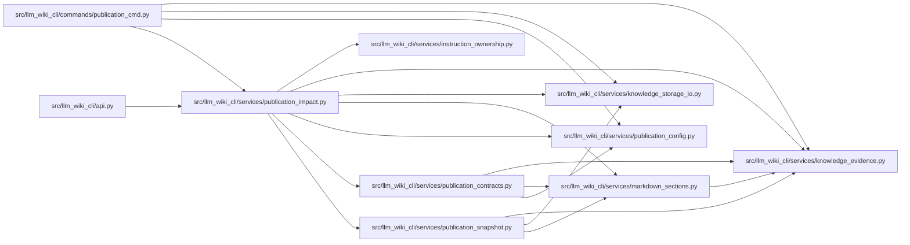

# publication_impact Module

**Path:** `src/llm_wiki_cli/services/publication_impact.py`

## Description

Portable, deterministic architecture-to-public-topic impact and review.

## Imports

| Source | Symbols |
|--------|---------|
| `.instruction_ownership` | `markdown_anchor` |
| `.knowledge_evidence` | `hash_json`, `sha256_bytes` |
| `.knowledge_storage_io` | `StorageReadSession` |
| `.markdown_sections` | `parse_markdown_document` |
| `.publication_config` | `load_publication_config`, `publication_path` |
| `.publication_contracts` | `PublicationProtocolError`, `validate_publication_basis`, `validate_publication_report`, `validate_publication_reviews` |
| `.publication_snapshot` | `build_publication_snapshot`, `build_bootstrap_publication_snapshot` |
| `__future__` | `annotations` |
| `collections` | `Counter` |
| `copy` | `deepcopy` |
| `fnmatch` | `fnmatchcase` |
| `json` | `json` |
| `pathlib` | `Path` |
| `typing` | `Any`, `Mapping` |

## Local dependency map

<!-- Auto-generated local dependency summary. Do not edit by hand. -->

### Internal neighbors

| Direction | Module |
|---|---|
| Inbound | [api](../modules/api.md) |
| Inbound | [publication_cmd](../modules/publication_cmd.md) |
| Outbound | [instruction_ownership](../modules/instruction_ownership.md) |
| Outbound | [knowledge_evidence](../modules/knowledge_evidence.md) |
| Outbound | [knowledge_storage_io](../modules/knowledge_storage_io.md) |
| Outbound | [markdown_sections](../modules/markdown_sections.md) |
| Outbound | [publication_config](../modules/publication_config.md) |
| Outbound | [publication_contracts](../modules/publication_contracts.md) |
| Outbound | [publication_snapshot](../modules/publication_snapshot.md) |

## Functions

| Function | Signature | Decorators | Description |
|----------|-----------|------------|-------------|
| `read_publication_document` | `(path: str \| Path) -> dict[str, Any]` | — | Read bounded JSON with unique keys and finite values. |
| `_unique_object` | `(pairs)` | — | — |
| `_invalid_constant` | `(value)` | — | — |
| `_seal` | `(value: dict[str, Any], key: str) -> dict[str, Any]` | — | — |
| `_file_hash` | `(session: StorageReadSession, root: Path, relative: str) -> str \| None` | — | — |
| `_topic_versions` | `(config, baseline)` | — | — |
| `_target_hash` | `(session: StorageReadSession, topic: Mapping[str, Any]) -> dict[str, Any]` | — | — |
| `capture_publication_basis` | `(consumer_root: str \| Path = '.', *, config_path: str \| Path = '.llm-wiki/publication.json', target_dir: str \| Path \| None = None, baseline: Mapping[str, Any] \| None = None) -> dict[str, Any]` | — | Capture a portable input basis without extraction or remote access. |
| `_dependency_basis` | `(dep: Mapping[str, Any], basis: Mapping[str, Any]) -> Any` | — | — |
| `_topic_inputs` | `(topic: Mapping[str, Any], basis: Mapping[str, Any]) -> dict[str, Any]` | — | — |
| `_finding` | `(kind: str, subject: str, details: Mapping[str, Any]) -> dict[str, Any]` | — | — |
| `_topic_findings` | `(before, after) -> list[dict[str, Any]]` | — | — |
| `compare_publication_impact` | `(candidate: Mapping[str, Any], baseline: Mapping[str, Any] \| None = None, *, reviews: Mapping[str, Any] \| None = None) -> dict[str, Any]` | — | Compare complete bases through the union of previous/current bindings. |
| `resolve_publication_finding` | `(report: Mapping[str, Any], candidate: Mapping[str, Any], *, finding_id: str, reviewer: str, reason: str, reviews: Mapping[str, Any] \| None = None) -> dict[str, Any]` | — | Prepare an exact-basis no-edit decision for normal repository review. |
| `render_publication_impact` | `(report: Mapping[str, Any]) -> str` | — | Render inert Markdown for CI summaries, including unresolved coverage. |
