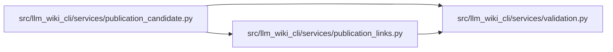

# publication_links Module

**Path:** `src/llm_wiki_cli/services/publication_links.py`

## Description

Pure Markdown rewriting and checks for portable GitHub wiki candidates.

## Imports

| Source | Symbols |
|--------|---------|
| `.validation` | `portable_path_key`, `require_portable_relative_path` |
| `__future__` | `annotations` |
| `collections.abc` | `Mapping` |
| `html` | `unescape` |
| `html.parser` | `HTMLParser` |
| `markdown_it` | `MarkdownIt` |
| `posixpath` | `posixpath` |
| `re` | `re` |
| `typing` | `Any` |
| `urllib.parse` | `quote`, `unquote`, `urlsplit`, `urlunsplit` |

## Local dependency map

<!-- Auto-generated local dependency summary. Do not edit by hand. -->

### Internal neighbors

| Direction | Module |
|---|---|
| Inbound | [publication_candidate](../modules/publication_candidate.md) |
| Outbound | [validation](../modules/validation.md) |

### External packages

| Language | Used packages | Undeclared packages |
|---|---:|---:|
| python | 1 | 1 |

## Classes

| Class | Line | Bases | Description |
|-------|------|-------|-------------|
| [_HTML](../entities/HTML.md) | 449 | `HTMLParser` | — |

## Functions

| Function | Signature | Decorators | Description |
|----------|-----------|------------|-------------|
| `_bounded_path` | `(path: str) -> str` | — | — |
| `_path` | `(value: object) -> str` | — | — |
| `_page_path` | `(value: object) -> str` | — | — |
| `_route` | `(path: str) -> str` | — | — |
| `_parse` | `(text: str)` | — | — |
| `_record_span` | `(rule)` | — | — |
| `_blank` | `(text: str) -> str` | — | — |
| `_line_match` | `(text, part, start, end)` | — | — |
| `_inline_offsets` | `(text, token, offsets, cursors)` | — | — |
| `_visible` | `(text: str, tokens) -> str` | — | — |
| `_escaped` | `(text: str, position: int) -> bool` | — | — |
| `_destination` | `(text: str, start: int) -> tuple[int, int] \| None` | — | — |
| `_resources` | `(visible: str)` | — | — |
| `_url` | `(value: str)` | — | — |
| `_relative` | `(path: str, parent: str = '') -> str` | — | — |
| `_append_url` | `(path: str, parsed) -> str` | — | — |
| `_repository_link` | `(path: str, parsed, repository_url: str \| None, source_revision: str \| None) -> str` | — | — |
| `_resource_identity` | `(value: str)` | — | — |
| `prepare_wiki_markdown` | `(text: str, *, source_path: str, source_pages: Mapping[str, str], source_assets: Mapping[str, str], repository_url: str \| None = None, source_revision: str \| None = None) -> str` | — | Rewrite declared source links without loading application code or files. |
| `_plain` | `(children) -> str` | — | — |
| `_slug` | `(text: str) -> str` | — | — |
| `check_github_wiki` | `(files: Mapping[str, bytes]) -> dict[str, Any]` | — | Check a complete candidate without filesystem or network access. |
