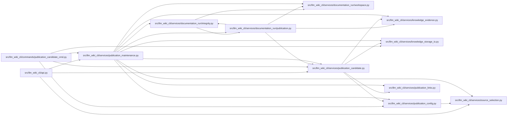

# publication_maintenance Module

**Path:** `src/llm_wiki_cli/services/publication_maintenance.py`

## Description

Turn independently reviewed workspace edits into consumer-owned Markdown patches.

## Imports

| Source | Symbols |
|--------|---------|
| `.documentation_run.integrity` | `_verify_read_only_inputs` |
| `.documentation_run.publication` | `bind_publication_workspace`, `collect_reviewed_publication_edits` |
| `.documentation_run.workspace` | `_load_bound_runtime_policy`, `load_documentation_run` |
| `.knowledge_evidence` | `hash_json`, `sha256_bytes` |
| `.knowledge_storage_io` | `StorageReadSession`, `_absolute_path` |
| `.publication_candidate` | `MAX_FILE_BYTES`, `MAX_TREE_BYTES`, `_candidate_path`, `_hashes`, `_read_tree`, `check_publication_candidate` |
| `.publication_config` | `PUBLICATION_CONFIG_PATH`, `publication_control_overlap`, `publication_path` |
| `.publication_links` | `check_github_wiki`, `prepare_wiki_markdown` |
| `.source_selection` | `resolve_source_selection` |
| `__future__` | `annotations` |
| `collections.abc` | `Mapping`, `Sequence` |
| `difflib` | `difflib` |
| `io` | `StringIO` |
| `json` | `json` |
| `os.path` | `os.path` |
| `pathlib` | `Path` |
| `typing` | `Any` |

## Local dependency map

<!-- Auto-generated local dependency summary. Do not edit by hand. -->

### Internal neighbors

| Direction | Module |
|---|---|
| Inbound | [api](../modules/api.md) |
| Inbound | [publication_candidate_cmd](../modules/publication_candidate_cmd.md) |
| Outbound | [integrity](../modules/integrity.md) |
| Outbound | [publication](../modules/publication.md) |
| Outbound | [workspace](../modules/workspace.md) |
| Outbound | [knowledge_evidence](../modules/knowledge_evidence.md) |
| Outbound | [knowledge_storage_io](../modules/knowledge_storage_io.md) |
| Outbound | [publication_candidate](../modules/publication_candidate.md) |
| Outbound | [publication_config](../modules/publication_config.md) |
| Outbound | [publication_links](../modules/publication_links.md) |
| Outbound | [source_selection](../modules/source_selection.md) |

## Functions

| Function | Signature | Decorators | Description |
|----------|-----------|------------|-------------|
| `_binding` | `(checked, topic_ids)` | — | — |
| `_validate_workspace` | `(workspace, root, candidate_dir, config)` | — | — |
| `_line_count` | `(text: str) -> int` | — | — |
| `_linear_hunk` | `(old: str, new: str, old_name: str, new_name: str)` | — | Use a single contextual hunk without quadratic matching of long documents. |
| `_document_patch` | `(path: str, before: bytes, after: bytes) -> str` | — | — |
| `_checked_preview` | `(candidate: Path, checked, edited)` | — | — |
| `_maintenance` | `(root, workspace, candidate_dir, receipt, topic_ids, options, *, produce_patch)` | — | — |
| `prepare_publication_maintenance` | `(consumer_root: str \| Path = '.', *, workspace: str \| Path, candidate_dir: str \| Path, receipt: Mapping[str, Any], topic_ids: Sequence[str] \| None = None, config_path: str \| Path = PUBLICATION_CONFIG_PATH, target_dir: str \| Path \| None = None, baseline: Mapping[str, Any] \| None = None, reviews: Mapping[str, Any] \| None = None, previous_receipt: Mapping[str, Any] \| None = None, candidate_review: Mapping[str, Any] \| None = None) -> dict[str, Any]` | — | Seed a prepared documentation workspace with unresolved mapped source text. |
| `build_publication_patch` | `(consumer_root: str \| Path = '.', *, workspace: str \| Path, candidate_dir: str \| Path, receipt: Mapping[str, Any], topic_ids: Sequence[str] \| None = None, config_path: str \| Path = PUBLICATION_CONFIG_PATH, target_dir: str \| Path \| None = None, baseline: Mapping[str, Any] \| None = None, reviews: Mapping[str, Any] \| None = None, previous_receipt: Mapping[str, Any] \| None = None, candidate_review: Mapping[str, Any] \| None = None) -> dict[str, Any]` | — | Propose an exact Git patch from verified author and independent review results. |
