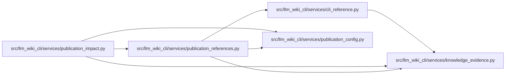

# publication_references Module

**Path:** `src/llm_wiki_cli/services/publication_references.py`

## Description

Explicit, inert reference inputs for public documentation review.

## Imports

| Source | Symbols |
|--------|---------|
| `.cli_reference` | `get_cli_contract`, `parse_cli_contract`, `get_cli_contract` |
| `.knowledge_evidence` | `hash_json` |
| `.publication_config` | `publication_path` |
| `__future__` | `annotations` |
| `copy` | `deepcopy` |
| `json` | `json` |
| `typing` | `Any`, `Mapping` |

## Local dependency map

<!-- Auto-generated local dependency summary. Do not edit by hand. -->

### Internal neighbors

| Direction | Module |
|---|---|
| Inbound | [publication_impact](../modules/publication_impact.md) |
| Outbound | [cli_reference](../modules/cli_reference.md) |
| Outbound | [knowledge_evidence](../modules/knowledge_evidence.md) |
| Outbound | [publication_config](../modules/publication_config.md) |

## Functions

| Function | Signature | Decorators | Description |
|----------|-----------|------------|-------------|
| `reference_identity` | `(provider: str, configuration: Mapping[str, Any]) -> str` | — | — |
| `capture_reference_inputs` | `(config, baseline, root, session)` | — | Read current and former providers through the caller's guarded session. |
| `recheck_reference_inputs` | `(captured, root)` | — | Recheck missing files and installed declarations after capture. |
| `reference_dependency_basis` | `(dep, basis, providers)` | — | Select one command subtree, retaining the provider's origin binding. |
| `_ancestor_context` | `(command)` | — | Global parser declarations also govern a selected descendant command. |
