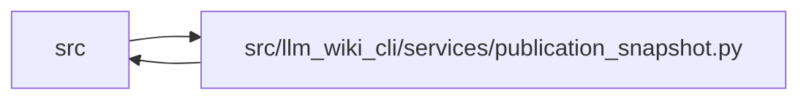

# publication_snapshot Module

**Path:** `src/llm_wiki_cli/services/publication_snapshot.py`

## Description

Complete, read-only native page commitments for documentation publication.

## Imports

| Source | Symbols |
|--------|---------|
| `.bootstrap_runtime` | `execute_bootstrap` |
| `.bootstrap_service` | `BootstrapRequest`, `BootstrapServiceError` |
| `.contracts` | `GOVERNANCE_EXTENSION_KEY`, `SECTION_OWNERSHIP_EXTENSION_KEY` |
| `.helper_runtime` | `helper_operation` |
| `.io` | `decode_markdown_bytes` |
| `.knowledge_evidence` | `hash_json`, `sha256_bytes` |
| `.knowledge_governance` | `GOVERNANCE_FILENAME` |
| `.knowledge_model` | `_bundle_to_payload` |
| `.knowledge_storage` | `MAX_EXPANDED_BYTES`, `KnowledgeStorageError` |
| `.knowledge_storage_io` | `_absolute_path` |
| `.knowledge_storage_lifecycle` | `_committed_inputs` |
| `.maintenance_protocol` | `guard_maintenance_owner` |
| `.markdown_sections` | `parse_markdown_document` |
| `.sync_manifest` | `MANIFEST_FILENAME` |
| `.wiki_surface` | `collect_wiki_pages` |
| `__future__` | `annotations` |
| `collections.abc` | `Mapping` |
| `copy` | `deepcopy` |
| `os` | `os` |
| `pathlib` | `Path` |
| `tempfile` | `TemporaryDirectory` |
| `typing` | `Any` |

## Local dependency map

<!-- Auto-generated local dependency summary. Do not edit by hand. -->

> Module-level dependencies exceed the generated-diagram limits, so the diagram and table below group them by top-level package. Counts report the number of module neighbors in each package.

### Internal neighbors

| Direction | Module |
|---|---|
| Inbound | `src` (1) |
| Outbound | `src` (15) |

> All 16 module neighbor(s) are summarized by package because the module-level view exceeds the 12-node limit.

## Classes

| Class | Line | Bases | Description |
|-------|------|-------|-------------|
| [PublicationSnapshotError](../entities/PublicationSnapshotError.md) | 29 | `ValueError` | A complete, coherent publication input could not be established. |

## Functions

| Function | Signature | Decorators | Description |
|----------|-----------|------------|-------------|
| `build_publication_snapshot` | `(wiki_dir: str \| Path) -> dict[str, Any]` | — | Commit every canonical native page without extracting source or writing. |
| `build_bootstrap_publication_snapshot` | `(source_root: Path) -> dict[str, Any]` | — | Build an isolated source-adapter wiki and return its native commitments. |
| `_build_snapshot` | `(root: Path) -> dict[str, Any]` | — | — |
