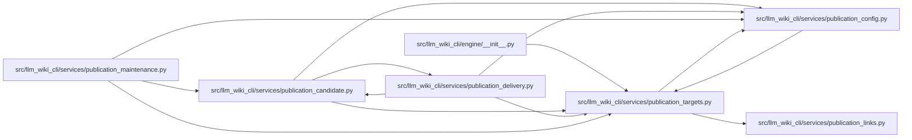

# publication_targets Module

**Path:** `src/llm_wiki_cli/services/publication_targets.py`

## Description

Publication targets: where a reviewed documentation candidate is delivered.

A :class:`PublicationTarget` owns the rules of one ``target.kind`` value in a
publication policy:

* :meth:`~PublicationTarget.check_repository` validates the policy's
  ``target.repository`` identifier and the repositories a delivery names;
* :meth:`~PublicationTarget.prepare_page` turns an authored Markdown page into
  the text the target publishes (rewriting links, for instance);
* :meth:`~PublicationTarget.check` checks a complete candidate tree without
  filesystem or network access and returns the ``{"ok", "findings"}`` report
  stored in a candidate receipt.

A :class:`PublicationTargetRegistry` maps kinds to targets. The default holds
:class:`GitHubWikiTarget` (``"github-wiki"``) only. A host adds targets with
:func:`using_publication_targets` or ``Engine(publication_targets=...)``; a
policy naming a kind no registered target serves is refused. A registry with
custom targets changes the candidate provider fingerprint, so a receipt
prepared under one set of targets is not trusted under another.

Delivery planning stays a pure composition of files: no target mutates a
remote inside the package. The policy shape (``kind``, ``repository``,
``branch``) and flat ``.md`` page names are fixed by the publication policy
format.

## Imports

| Source | Symbols |
|--------|---------|
| `.` | `publication_links`, `publication_links` |
| `.publication_config` | `publication_repository` |
| `__future__` | `annotations` |
| `collections.abc` | `Iterator`, `Mapping` |
| `contextlib` | `contextmanager` |
| `contextvars` | `ContextVar` |
| `dataclasses` | `dataclass`, `replace` |
| `typing` | `Any` |

## Local dependency map

<!-- Auto-generated local dependency summary. Do not edit by hand. -->

### Internal neighbors

| Direction | Module |
|---|---|
| Inbound | [engine___init__](../modules/engine___init__.md) |
| Inbound | [publication_candidate](../modules/publication_candidate.md) |
| Inbound | [publication_config](../modules/publication_config.md) |
| Inbound | [publication_delivery](../modules/publication_delivery.md) |
| Inbound | [publication_maintenance](../modules/publication_maintenance.md) |
| Outbound | [publication_config](../modules/publication_config.md) |
| Outbound | [publication_links](../modules/publication_links.md) |

## Classes

| Class | Line | Bases | Description |
|-------|------|-------|-------------|
| [PublicationTarget](../entities/PublicationTarget.md) | 36 | — | The rules of one publication target kind. |
| [GitHubWikiTarget](../entities/GitHubWikiTarget.md) | 80 | `PublicationTarget` | A GitHub wiki: flat Markdown pages, ``Home.md`` required, ``owner/repo`` names. |
| [PublicationTargetRegistry](../entities/PublicationTargetRegistry.md) | 121 | — | The publication targets a policy may name, keyed by ``target.kind``. |

## Functions

| Function | Signature | Decorators | Description |
|----------|-----------|------------|-------------|
| `current_publication_targets` | `() -> PublicationTargetRegistry` | — | The registry chosen for this context, or :data:`DEFAULT_PUBLICATION_TARGETS`. |
| `publication_target` | `(kind: str) -> PublicationTarget` | — | The target serving ``kind`` in this context. |
| `using_publication_targets` | `(registry: PublicationTargetRegistry) -> Iterator[PublicationTargetRegistry]` | `@contextmanager` | Publish to the targets of ``registry`` inside the block. |
