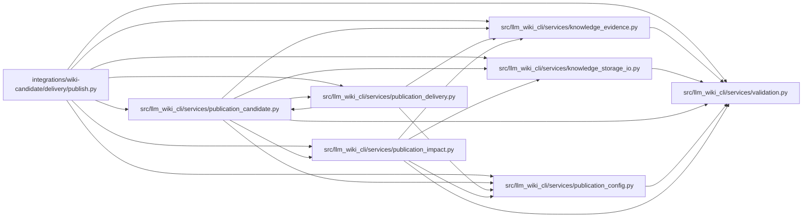

# publish Module

**Path:** `integrations/wiki-candidate/delivery/publish.py`

## Description

Protected GitHub Actions entry point for reviewed wiki delivery.

## Imports

| Source | Symbols |
|--------|---------|
| `__future__` | `annotations` |
| `importlib` | `importlib` |
| `io` | `BytesIO` |
| `json` | `json` |
| `llm_wiki_cli.services.knowledge_evidence` | `hash_json`, `sha256_bytes` |
| `llm_wiki_cli.services.knowledge_storage_io` | `read_guarded` |
| `llm_wiki_cli.services.publication_candidate` | `MAX_FILE_BYTES`, `MAX_FILES`, `MAX_TREE_BYTES`, `_provider`, `validate_publication_receipt` |
| `llm_wiki_cli.services.publication_config` | `publication_ref_name`, `read_publication_json`, `validate_publication_config` |
| `llm_wiki_cli.services.publication_delivery` | `validate_rollback_review` |
| `llm_wiki_cli.services.publication_impact` | `MAX_JSON_BYTES`, `compare_publication_impact`, `read_publication_document` |
| `llm_wiki_cli.services.validation` | `require_portable_relative_path` |
| `os` | `os` |
| `pathlib` | `Path` |
| `stat` | `stat` |
| `sys` | `sys` |
| `zipfile` | `ZIP_DEFLATED`, `ZIP_STORED`, `ZipFile` |

## Local dependency map

<!-- Auto-generated local dependency summary. Do not edit by hand. -->

### Internal neighbors

| Direction | Module |
|---|---|
| Outbound | [knowledge_evidence](../modules/knowledge_evidence.md) |
| Outbound | [knowledge_storage_io](../modules/knowledge_storage_io.md) |
| Outbound | [publication_candidate](../modules/publication_candidate.md) |
| Outbound | [publication_config](../modules/publication_config.md) |
| Outbound | [publication_delivery](../modules/publication_delivery.md) |
| Outbound | [publication_impact](../modules/publication_impact.md) |
| Outbound | [validation](../modules/validation.md) |

## Functions

| Function | Signature | Decorators | Description |
|----------|-----------|------------|-------------|
| `hosted_context` | `(operation: str) -> dict[str, str]` | — | — |
| `artifact_files` | `(incoming: Path, receipt: dict, archive_hash: str) -> dict[str, bytes]` | — | — |
| `checked_artifact` | `(incoming: Path, runtime: Path, context: dict, policy: dict, expected_receipt: str, accepted_pin: str) -> tuple[dict, dict[str, bytes]]` | — | — |
| `committed_record` | `(root: Path, prefix: Path, pin: str, path: str, runtime: Path, name: str, limit: int = MAX_JSON_BYTES) -> dict` | — | — |
| `accepted_reviews` | `(root, prefix, pin, runtime, receipt, paths)` | — | — |
| `run` | `() -> None` | — | — |
