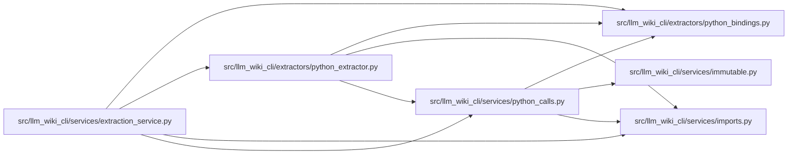

# python_calls Module

**Path:** `src/llm_wiki_cli/services/python_calls.py`

## Description

Shared Python call resolution using captured lexical binding evidence.

An optional source-captured witness resolves direct calls to closure-free,
unescaped local functions with unique enclosing declarations and aligned call
sites. Missing, invalid, mutable or ambiguous witnesses retain unresolved
results. Legacy call bindings and the four-tuple adapter remain available;
static targets do not establish runtime execution.

## Imports

| Source | Symbols |
|--------|---------|
| `..extractors.python_bindings` | `valid_python_constructor_facts`, `CONSTRUCTOR_DISPATCH_VERSION` |
| `.immutable` | `freeze` |
| `.imports` | `ModulePathResolver` |
| `__future__` | `annotations` |
| `collections.abc` | `Mapping` |
| `copy` | `deepcopy` |
| `dataclasses` | `dataclass` |
| `typing` | `TYPE_CHECKING` |

## Local dependency map

<!-- Auto-generated local dependency summary. Do not edit by hand. -->

### Internal neighbors

| Direction | Module |
|---|---|
| Inbound | [python_extractor](../modules/python_extractor.md) |
| Inbound | [extraction_service](../modules/extraction_service.md) |
| Outbound | [python_bindings](../modules/python_bindings.md) |
| Outbound | [immutable](../modules/immutable.md) |
| Outbound | [imports](../modules/imports.md) |

## Classes

| Class | Line | Bases | Description |
|-------|------|-------|-------------|
| [PythonCallContext](../entities/PythonCallContext.md) | 111 | — | — |
| [PythonCallDecision](../entities/PythonCallDecision.md) | 119 | — | — |
| [_PythonCallResolver](../entities/PythonCallResolver.md) | 208 | — | — |

## Functions

| Function | Signature | Decorators | Description |
|----------|-----------|------------|-------------|
| `_lexical_table` | `(data: Mapping) -> tuple[dict, list] \| None` | — | Validate optional lexical witnesses without changing legacy bindings. |
| `_lexical_call` | `(call, filepath, data, context, binding)` | — | — |
| `_declarations` | `(data: Mapping, name: str)` | — | — |
| `_declared_symbol` | `(data: Mapping, name: str) -> bool` | — | — |
| `_module_binding` | `(data: Mapping, name: str) -> dict` | — | — |
| `_invocation_location` | `(call, binding, filepath)` | — | — |
| `resolve_python_call_decision` | `(call: dict, filepath: str, data: dict, context: PythonCallContext) -> PythonCallDecision` | — | Make one immutable static decision from captured lexical evidence. |
| `resolve_python_call` | `(call: dict, filepath: str, data: dict, context: PythonCallContext)` | — | Retain the four-tuple compatibility adapter for the shared decision. |
