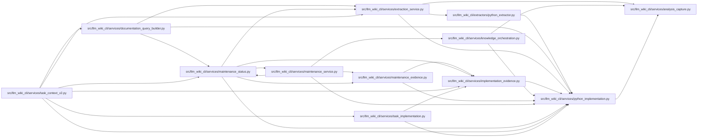

# python_implementation Module

**Path:** `src/llm_wiki_cli/services/python_implementation.py`

## Description

Bounded executable-syntax observations from an already captured Python AST.

No source is opened or application imported here. Available digests describe
captured syntax, never dependencies, prose correctness, or runtime equivalence.

## Imports

| Source | Symbols |
|--------|---------|
| `.analysis_capture` | `_CapturedAnalysis` |
| `__future__` | `annotations` |
| `ast` | `ast` |
| `collections` | `Counter` |
| `collections.abc` | `Mapping` |
| `hashlib` | `hashlib` |
| `io` | `io` |
| `json` | `json` |
| `math` | `math` |
| `pathlib` | `PurePosixPath` |
| `platform` | `platform` |
| `re` | `re` |
| `sys` | `sys` |
| `tokenize` | `tokenize` |
| `typing` | `Any` |

## Local dependency map

<!-- Auto-generated local dependency summary. Do not edit by hand. -->

### Internal neighbors

| Direction | Module |
|---|---|
| Inbound | [python_extractor](../modules/python_extractor.md) |
| Inbound | [documentation_query_builder](../modules/documentation_query_builder.md) |
| Inbound | [extraction_service](../modules/extraction_service.md) |
| Inbound | [implementation_evidence](../modules/implementation_evidence.md) |
| Inbound | [knowledge_orchestration](../modules/knowledge_orchestration.md) |
| Inbound | [maintenance_evidence](../modules/maintenance_evidence.md) |
| Inbound | [maintenance_service](../modules/maintenance_service.md) |
| Inbound | [maintenance_status](../modules/maintenance_status.md) |
| Inbound | [task_context_v2](../modules/task_context_v2.md) |
| Inbound | [task_implementation](../modules/task_implementation.md) |
| Outbound | [analysis_capture](../modules/analysis_capture.md) |

## Functions

| Function | Signature | Decorators | Description |
|----------|-----------|------------|-------------|
| `canonical_bytes` | `(value: Any) -> bytes` | — | — |
| `_digest` | `(value: Any) -> str` | — | — |
| `analysis_identity` | `(captured: object) -> str \| None` | — | Bind only issuer-owned surrounding code/runtime and normalization config. |
| `producer` | `(analysis_hash: str \| None, *, language = 'python') -> dict[str, str] \| None` | — | — |
| `comparison_id` | `(value: Mapping[str, Any]) -> str` | — | — |
| `coordinate_supported` | `(coordinate: Mapping[str, Any], scope: str) -> bool` | — | — |
| `_docstring` | `(node: ast.AST) -> str \| None` | — | — |
| `_scalar` | `(value: Any) -> Any` | — | — |
| `_normalize` | `(value: Any) -> Any` | — | — |
| `_declarations` | `(tree: ast.AST, path: str)` | — | — |
| `_documentation` | `(node: ast.AST) -> list[dict[str, Any]]` | — | — |
| `_evidence` | `(node: ast.AST \| None, coordinate: dict[str, Any], scope: str, source_hash: str \| None, configured: dict[str, str], reason: str \| None) -> dict[str, Any]` | — | — |
| `capture` | `(tree: ast.Module \| None, data: bytes \| None, source_path: str, *, configured: dict[str, str] \| None, reason: str \| None = None, parsed_source: str \| None = None) -> dict[str, Any]` | — | Capture per-file rows from the same tree/bytes used by extraction. |
| `envelope` | `(files: Mapping[str, dict]) -> dict[str, Any]` | — | — |
