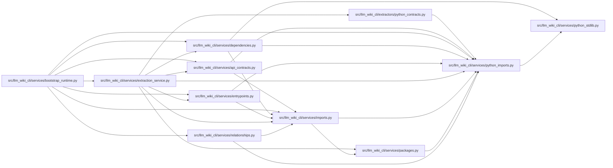

# python_imports Module

**Path:** `src/llm_wiki_cli/services/python_imports.py`

## Description

Python import roots and captured module bindings over selected inventory.

Separates module-root resolution from module namespace authority. Captured Python binding facts select matching imports for alias consumers, while dependency analysis retains all lexical imports. Inventories without binding capture retain their existing import-based compatibility fallback; that fallback does not establish live namespace correctness.

## Imports

| Source | Symbols |
|--------|---------|
| `.python_stdlib` | `python_stdlib_module_names` |
| `__future__` | `annotations` |
| `collections` | `defaultdict` |
| `collections.abc` | `Mapping` |
| `dataclasses` | `dataclass` |
| `pathlib` | `PurePosixPath` |
| `posixpath` | `posixpath` |
| `sys` | `sys` |

## Local dependency map

<!-- Auto-generated local dependency summary. Do not edit by hand. -->

### Internal neighbors

| Direction | Module |
|---|---|
| Inbound | [python_contracts](../modules/python_contracts.md) |
| Inbound | [api_contracts](../modules/api_contracts.md) |
| Inbound | [bootstrap_runtime](../modules/bootstrap_runtime.md) |
| Inbound | [services_dependencies](../modules/services_dependencies.md) |
| Inbound | [entrypoints](../modules/entrypoints.md) |
| Inbound | [extraction_service](../modules/extraction_service.md) |
| Inbound | [imports](../modules/imports.md) |
| Inbound | [packages](../modules/packages.md) |
| Inbound | [relationships](../modules/relationships.md) |
| Outbound | [python_stdlib](../modules/python_stdlib.md) |

## Classes

| Class | Line | Bases | Description |
|-------|------|-------|-------------|
| [PythonImportScope](../entities/PythonImportScope.md) | 63 | — | — |
| [PythonModuleIndex](../entities/PythonModuleIndex.md) | 70 | — | — |

## Functions

| Function | Signature | Decorators | Description |
|----------|-----------|------------|-------------|
| `module_binding_imports` | `(file_data: Mapping) -> list[dict]` | — | Dependency imports imply module aliases only with matching binding facts. |
| `is_python_source` | `(filepath: str, data: object = None) -> bool` | — | — |
| `normalized_root` | `(value: object) -> str \| None` | — | — |
| `under_root` | `(path: str, root: str) -> bool` | — | — |
| `_relative_target` | `(module: str, importer: str) -> str \| None` | — | — |
