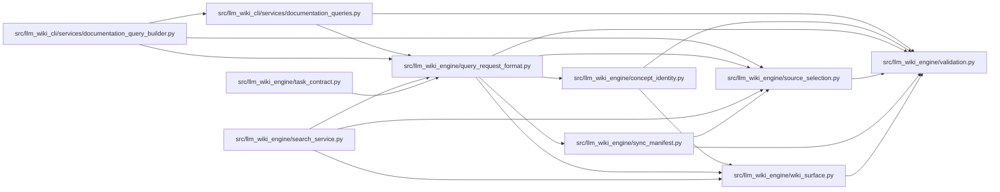

# query_request_format Module

**Path:** `src/llm_wiki_engine/query_request_format.py`

## Description

Request checks shared by documentation query services.

These checks bound and normalize what a caller asks a documentation query
for (limits, exact coordinates and supplied source paths) before any source
or wiki is read, and require a live query's source selection to match the
boundary the wiki was generated with. Answering the query is the
application's work.

## Imports

| Source | Symbols |
|--------|---------|
| `.` | `wiki_surface` |
| `.concept_identity` | `ConceptIdentityError`, `validate_concept_uid`, `validate_natural_key` |
| `.source_selection` | `SourceSelectionError`, `validate_persisted_source_selection_identity` |
| `.sync_manifest` | `SyncManifest`, `SyncManifestError` |
| `.validation` | `require_portable_relative_path` |
| `__future__` | `annotations` |
| `collections.abc` | `Iterable`, `Mapping` |
| `itertools` | `islice` |
| `os` | `os` |
| `pathlib` | `Path` |

## Local dependency map

<!-- Auto-generated local dependency summary. Do not edit by hand. -->

### Internal neighbors

| Direction | Module |
|---|---|
| Inbound | [documentation_queries](../modules/documentation_queries.md) |
| Inbound | [documentation_query_builder](../modules/documentation_query_builder.md) |
| Inbound | [search_service](../modules/search_service.md) |
| Inbound | [task_contract](../modules/task_contract.md) |
| Outbound | [concept_identity](../modules/concept_identity.md) |
| Outbound | [source_selection](../modules/source_selection.md) |
| Outbound | [sync_manifest](../modules/sync_manifest.md) |
| Outbound | [validation](../modules/validation.md) |
| Outbound | [wiki_surface](../modules/wiki_surface.md) |

## Classes

| Class | Line | Bases | Description |
|-------|------|-------|-------------|
| [DocumentationQueryError](../entities/DocumentationQueryError.md) | 30 | `ValueError` | Raised when a documentation graph query request is invalid. |

## Functions

| Function | Signature | Decorators | Description |
|----------|-----------|------------|-------------|
| `normalize_documentation_query_limit` | `(value: object) -> int` | — | Return the shared bounded query limit before any source work starts. |
| `normalize_documentation_query_text` | `(value: object, *, field: str) -> str` | — | Return one non-empty exact query coordinate. |
| `normalize_concept_coordinate` | `(value: object) -> str` | — | Validate a concept coordinate without attempting fuzzy resolution. |
| `_supplied_path_values` | `(values: object) -> list[object]` | — | Consume no more than the declared supplied-path request bound. |
| `_portable_supplied_path` | `(value: object) -> str` | — | Adapt shared portable-path validation to the query error contract. |
| `normalize_supplied_paths` | `(values: object) -> tuple[str, ...]` | — | Validate, deduplicate, and deterministically order supplied source paths. |
| `_wiki_has_persisted_read_state` | `(wiki_root: Path) -> bool` | — | Return whether a wiki contains anything beyond empty scaffolding. |
| `validate_live_query_source_selection` | `(*, source_root: Path, wiki_root: Path, live_identity: Mapping[str, object] \| None, live_selection_inputs: Mapping[str, object] \| None \| object = _UNSET_LIVE_SELECTION_INPUTS, operation: str, allow_empty_wiki: bool = False) -> None` | — | Require a live query profile to match the persisted wiki boundary. |
