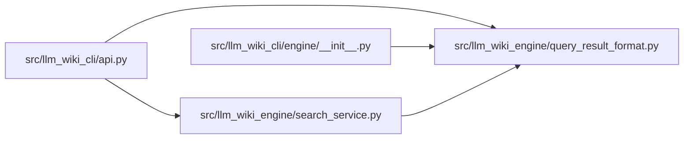

# query_result_format Module

**Path:** `src/llm_wiki_engine/query_result_format.py`

## Description

Format checks for documentation query results and wiki search results.

``llm-wiki-documentation-query/v1`` is the envelope ``query_documentation``
returns for every operation; ``llm-wiki-search-result/v1`` is what wiki
search returns from the CLI, MCP and the Python API. These checks read no
repository or wiki state.

## Imports

| Source | Symbols |
|--------|---------|
| `__future__` | `annotations` |
| `collections.abc` | `Mapping`, `Sequence` |
| `typing` | `Any` |

## Local dependency map

<!-- Auto-generated local dependency summary. Do not edit by hand. -->

### Internal neighbors

| Direction | Module |
|---|---|
| Inbound | [api](../modules/api.md) |
| Inbound | [engine___init__](../modules/engine___init__.md) |
| Inbound | [search_service](../modules/search_service.md) |

## Classes

| Class | Line | Bases | Description |
|-------|------|-------|-------------|
| [QueryResultError](../entities/QueryResultError.md) | 90 | `ValueError` | A documentation query or search result does not follow its format. |

## Functions

| Function | Signature | Decorators | Description |
|----------|-----------|------------|-------------|
| `validate_documentation_query_result` | `(document: object) -> None` | — | Raise ``QueryResultError`` unless *document* is a documentation query result. |
| `validate_search_result` | `(document: object) -> None` | — | Raise ``QueryResultError`` unless *document* is a wiki search result. |
| `_search_match` | `(match: Mapping[str, Any], mode: str, *, indexed: bool, field: str) -> None` | — | — |
| `_payload_field` | `(name: str, value: object) -> None` | — | — |
| `_cost` | `(value: object) -> None` | — | — |
| `_bound` | `(value: object, field: str) -> bool` | — | — |
| `_fields` | `(value: Mapping[str, Any], required: set[str] \| frozenset[str], optional: set[str] \| frozenset[str], field: str) -> None` | — | — |
| `_object` | `(value: object, field: str) -> Mapping[str, Any]` | — | — |
| `_list` | `(value: object, field: str) -> Sequence[Any]` | — | — |
| `_objects` | `(value: object, field: str) -> list[Mapping[str, Any]]` | — | — |
| `_strings` | `(value: object, field: str) -> None` | — | — |
| `_count` | `(value: object, field: str) -> int` | — | — |
| `_boolean` | `(value: object, field: str) -> None` | — | — |
| `_text` | `(value: object, field: str) -> None` | — | — |
