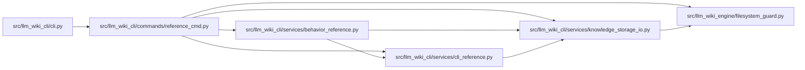

# reference_cmd Module

**Path:** `src/llm_wiki_cli/commands/reference_cmd.py`

## Description

Generate or render versioned CLI and behavior reference data.

## Imports

| Source | Symbols |
|--------|---------|
| `..services.behavior_reference` | `MAX_BEHAVIOR_FACTS_BYTES`, `get_behavior_facts`, `load_behavior_facts`, `render_behavior_reference` |
| `..services.cli_reference` | `MAX_CLI_CONTRACT_BYTES`, `get_cli_contract`, `load_cli_contract`, `render_cli_reference` |
| `..services.knowledge_storage_io` | `StorageReadSession`, `_absolute_path` |
| `__future__` | `annotations` |
| `json` | `json` |
| `llm_wiki_engine.filesystem_guard` | `atomic_write_private_bytes`, `ensure_guarded_directory` |
| `pathlib` | `Path` |
| `sys` | `sys` |

## Local dependency map

<!-- Auto-generated local dependency summary. Do not edit by hand. -->

### Internal neighbors

| Direction | Module |
|---|---|
| Inbound | [cli](../modules/cli.md) |
| Outbound | [behavior_reference](../modules/behavior_reference.md) |
| Outbound | [cli_reference](../modules/cli_reference.md) |
| Outbound | [knowledge_storage_io](../modules/knowledge_storage_io.md) |
| Outbound | [filesystem_guard](../modules/filesystem_guard.md) |

## Functions

| Function | Signature | Decorators | Description |
|----------|-----------|------------|-------------|
| `_reference` | `(args)` | — | — |
| `run` | `(args)` | — | — |
