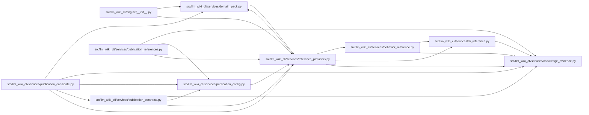

# reference_providers Module

**Path:** `src/llm_wiki_cli/services/reference_providers.py`

## Description

Reference providers: declared contracts that public documentation depends on.

A publication policy declares ``reference_providers`` by ``kind`` and lets
topics depend on a whole reference or on a selected part of it. A
:class:`ReferenceProvider` owns one kind:

* :attr:`~ReferenceProvider.reads_file` says where its contract comes from.
  A file provider's configuration names a repository JSON file
  (``{"kind", "path"}``) that :meth:`~ReferenceProvider.parse` reads; a
  missing file is recorded as known-missing input. Any other provider's
  configuration is ``{"kind"}`` alone and :meth:`~ReferenceProvider.capture`
  observes the contract from the running installation;
* :meth:`~ReferenceProvider.normalize_selector` validates a topic dependency
  on the provider and returns its normalized form;
* :meth:`~ReferenceProvider.validate_contract` checks a captured contract
  stored in publication evidence;
* :meth:`~ReferenceProvider.select` commits the selected part of a contract
  as a digest, or returns ``None`` when the selection is absent.

Domain packs contribute providers (``DomainPack.reference_providers``); the
code-documentation pack contributes :data:`BUILTIN_REFERENCE_PROVIDERS`: the
installed ``llm-wiki-cli`` command contract, the installed
``llm-wiki-behavior`` facts and ``contract-file`` command contracts. A policy
may only declare kinds the active pack provides. Providers are inert: they
read declarations and never execute the referenced program.

## Imports

| Source | Symbols |
|--------|---------|
| `.behavior_reference` | `BEHAVIOR_FACT_GROUPS`, `get_behavior_facts`, `validate_behavior_facts` |
| `.cli_reference` | `validate_cli_contract`, `get_cli_contract`, `parse_cli_contract` |
| `.domain_pack` | `current_pack` |
| `.knowledge_evidence` | `hash_json` |
| `__future__` | `annotations` |
| `collections.abc` | `Mapping` |
| `re` | `re` |
| `typing` | `Any` |

## Local dependency map

<!-- Auto-generated local dependency summary. Do not edit by hand. -->

### Internal neighbors

| Direction | Module |
|---|---|
| Inbound | [engine___init__](../modules/engine___init__.md) |
| Inbound | [domain_pack](../modules/domain_pack.md) |
| Inbound | [publication_candidate](../modules/publication_candidate.md) |
| Inbound | [publication_config](../modules/publication_config.md) |
| Inbound | [publication_contracts](../modules/publication_contracts.md) |
| Inbound | [publication_references](../modules/publication_references.md) |
| Outbound | [behavior_reference](../modules/behavior_reference.md) |
| Outbound | [cli_reference](../modules/cli_reference.md) |
| Outbound | [domain_pack](../modules/domain_pack.md) |
| Outbound | [knowledge_evidence](../modules/knowledge_evidence.md) |

## Classes

| Class | Line | Bases | Description |
|-------|------|-------|-------------|
| [ReferenceSelectorError](../entities/ReferenceSelectorError.md) | 40 | `ValueError` | A topic dependency selects a reference in a way its provider refuses. |
| [ReferenceContractError](../entities/ReferenceContractError.md) | 49 | `ValueError` | A stored contract could not have come from its provider. |
| [ReferenceProvider](../entities/ReferenceProvider.md) | 67 | — | The rules of one reference provider kind. |
| [_CommandSelector](../entities/CommandSelector.md) | 113 | `ReferenceProvider` | Dependencies select a command subtree: ``{"reference", "command": [...]}``. |
| [CliContractProvider](../entities/CliContractProvider.md) | 145 | `_CommandSelector` | The installed ``llm-wiki`` command-line contract. |
| [ContractFileProvider](../entities/ContractFileProvider.md) | 162 | `_CommandSelector` | A command-line contract file committed to the repository. |
| [BehaviorFactsProvider](../entities/BehaviorFactsProvider.md) | 175 | `ReferenceProvider` | The installed behavior facts; dependencies may select one fact group. |

## Functions

| Function | Signature | Decorators | Description |
|----------|-----------|------------|-------------|
| `_selector_fields` | `(dependency: Mapping[str, Any], field: str, optional: str) -> None` | — | — |
| `select_behavior_fact` | `(contract, fact)` | — | Commit one named behavior fact group. |
| `select_command` | `(contract, path)` | — | Commit a complete command contract or one command subtree. |
| `_ancestor_context` | `(command)` | — | Global parser declarations also govern a selected descendant command. |
| `check_reference_providers` | `(providers: object) -> tuple[ReferenceProvider, ...]` | — | Return ``providers`` as a tuple of distinct-kind providers or raise. |
| `reference_providers_identity` | `(providers: tuple[ReferenceProvider, ...]) -> Any` | — | ``None`` for the built-in providers, else a value naming every provider. |
| `current_reference_providers` | `() -> dict[str, ReferenceProvider]` | — | The active pack's providers keyed by kind. |
| `reference_provider` | `(kind: str) -> ReferenceProvider` | — | The active pack's provider for ``kind``; ``KeyError`` when it has none. |
