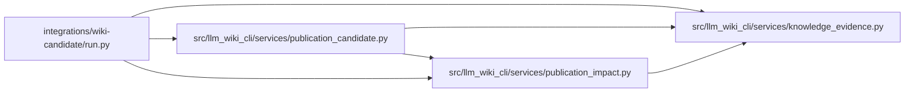

# run Module

**Path:** `integrations/wiki-candidate/run.py`

## Description

Verify consumer inputs and retain the exact public wiki candidate checked by CI.

## Imports

| Source | Symbols |
|--------|---------|
| `checkout` | `accepted_inputs`, `verified_checkout`, `verified_target` |
| `difflib` | `difflib` |
| `json` | `json` |
| `llm_wiki_cli.services.knowledge_evidence` | `sha256_bytes` |
| `llm_wiki_cli.services.publication_candidate` | `_read_tree`, `validate_publication_receipt` |
| `llm_wiki_cli.services.publication_impact` | `read_publication_document` |
| `os` | `os` |
| `pathlib` | `Path` |
| `subprocess` | `subprocess` |
| `sys` | `sys` |
| `zipfile` | `ZIP_DEFLATED`, `ZipFile`, `ZipInfo` |

## Local dependency map

<!-- Auto-generated local dependency summary. Do not edit by hand. -->

### Internal neighbors

| Direction | Module |
|---|---|
| Outbound | [knowledge_evidence](../modules/knowledge_evidence.md) |
| Outbound | [publication_candidate](../modules/publication_candidate.md) |
| Outbound | [publication_impact](../modules/publication_impact.md) |

### External packages

| Language | Used packages | Undeclared packages |
|---|---:|---:|
| python | 1 | 1 |

## Functions

| Function | Signature | Decorators | Description |
|----------|-----------|------------|-------------|
| `action_input` | `(name: str, default: str = '') -> str` | — | — |
| `run_cli` | `(action, options, consumer, evidence)` | — | — |
| `write_diff` | `(stream, path: str, before: bytes \| None, after: bytes \| None, operation: dict)` | — | — |
| `retain` | `(receipt, candidate, target, evidence)` | — | Build the upload from the same validated bytes used in the diff. |
| `run` | `(mode: str) -> None` | — | — |
