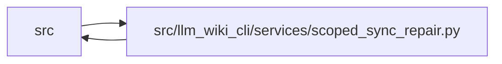

# scoped_sync_repair Module

**Path:** `src/llm_wiki_cli/services/scoped_sync_repair.py`

## Description

The scoped evidence writer limits page and structural-evidence application after a complete source inventory and global reconciliation. It requires an adopted coherent wiki, unchanged source and generation policy, and complete current built-in analysis commitments. A selected source's existing module and entity bases are repaired together; unselected structural failures stay explicitly unknown.

A producer upgrade is permitted when every retained known source observation is reproduced. Identical executable observations can re-anchor to the actual captured issuer, including its parser version. Changed issuer bindings reopen ordinary review without creating an acknowledgement or losing history. Source, syntax and prose facts, unselected page bytes, identities and the full typed graph remain protected. Wider changes require the ordinary full owning review.

Producer identities, opaque annotations and protected facts are compared as canonical JSON, preserving boolean/number and missing/null distinctions. Only declared transaction fields and verified executable issuer bindings are excluded. An isolated preflight checks the complete candidate, followed by checks of the actual plan and publication inputs. Provider/helper/runtime or source/selection mutations invalidate that operation; the adopted writer retains exact wiki custody and complete recovery preimages.

Scope does not narrow discovery or bypass normal count/ratio review. Full analysis, global artifacts and recovery can remain expensive. Whole-wiki strict validation is still required because an unselected unknown remains unknown. Repair selectors use canonical POSIX paths relative to the source root, with validation before deduplication and sorting.

## Imports

| Source | Symbols |
|--------|---------|
| `.` | `analysis_capture`, `analysis_compatibility` |
| `.contracts` | `SECTION_OWNERSHIP_EXTENSION_KEY` |
| `.implementation_evidence` | `IMPLEMENTATION_KEY`, `DECLARATIONS_KEY` |
| `.knowledge_artifacts` | `KnowledgeCommitPlan`, `validate_knowledge_artifacts` |
| `.knowledge_model` | `knowledge_index_to_payload` |
| `.knowledge_orchestration` | `RuntimeLiveEvaluationInputs`, `build_runtime_live_evaluation`, `runtime_generation_options`, `runtime_source_snapshot_hash`, `RUNTIME_GENERATION_OPTION_DEFAULTS` |
| `.knowledge_reuse` | `implementation_hash`, `wiki_input_hashes` |
| `.knowledge_storage` | `canonical_bytes`, `MAX_EXPANDED_BYTES` |
| `.knowledge_storage_io` | `read_guarded` |
| `.source_snapshot` | `SourceSnapshotError`, `source_snapshot_matches_current_files` |
| `.validation` | `require_repository_relative_path` |
| `.wiki_surface` | `collect_wiki_pages` |
| `__future__` | `annotations` |
| `collections` | `Counter` |
| `dataclasses` | `asdict`, `dataclass`, `replace` |
| `hashlib` | `hashlib` |
| `json` | `json` |
| `typing` | `Any` |

## Local dependency map

<!-- Auto-generated local dependency summary. Do not edit by hand. -->

> Module-level dependencies exceed the generated-diagram limits, so the diagram and table below group them by top-level package. Counts report the number of module neighbors in each package.

### Internal neighbors

| Direction | Module |
|---|---|
| Inbound | `src` (1) |
| Outbound | `src` (13) |

> All 14 module neighbor(s) are summarized by package because the module-level view exceeds the 12-node limit.

## Classes

| Class | Line | Bases | Description |
|-------|------|-------|-------------|
| [ScopedRepairError](../entities/ScopedRepairError.md) | 21 | `ValueError` | The requested repair cannot preserve its declared scope. |
| [ScopedRepairBoundary](../entities/ScopedRepairBoundary.md) | 137 | — | Original global inputs and the only concept pages allowed to change. |

## Functions

| Function | Signature | Decorators | Description |
|----------|-----------|------------|-------------|
| `_require` | `(condition: bool, reason: str) -> None` | — | — |
| `repair_paths` | `(value) -> tuple[str, ...]` | — | — |
| `_repair_path` | `(path) -> str` | — | — |
| `_recapture` | `(registry, root, helper_cache, languages)` | `@analysis_capture.capture_operation` | — |
| `_multiset` | `(values)` | — | — |
| `_markdown_hashes` | `(root)` | — | — |
| `_source_current` | `(snapshot)` | — | — |
| `_strip_implementation_issuer` | `(evidence)` | — | — |
| `_check_current_implementation_issuer` | `(evidence, captures)` | — | — |
| `_strip_concept_issuers` | `(concept, *, current_captures = None)` | — | — |
| `_strip_maintenance_issuer` | `(basis)` | — | — |
| `_check_maintenance_requalification` | `(left, right, record_id, captures)` | — | — |
| `prepare_boundary` | `(options, prepared) -> ScopedRepairBoundary` | — | Accept an adopted unchanged-source repair after complete revalidation. |