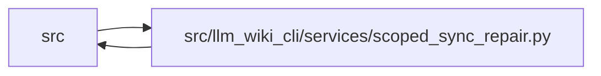

# scoped_sync_repair Module

**Path:** `src/llm_wiki_cli/services/scoped_sync_repair.py`

## Description

The scoped evidence writer limits application after a complete source inventory
and global reconciliation. It accepts only an adopted coherent wiki, unchanged
source and generation policy, and complete matching built-in producer commitments.
A selected source's existing module and entity bases are repaired together;
unselected failures, logical facts, authored bytes and review histories survive.

Protected JSON facts are compared canonically: nested booleans and numbers,
and missing extension keys and explicit null values, remain distinct. Only the
declared transaction metadata is excluded from the scope comparison.

The full typed graph and other global concepts must remain identical. Producer
transitions, new or retired identities, mixed edits and wider reconciliation
refuse partial application. An isolated preflight verifies the complete candidate,
then the actual plan is checked before the ordinary recoverable publication.
Provider/helper/runtime and source/selection changes invalidate that operation;
the adopted write basis also guards wiki bytes through manifest publication.

Scope never narrows source discovery or overrides the broad-update count/ratio
review. Whole-wiki strict validation remains necessary afterward because retained
unselected unknown evidence stays unknown.

## Imports

| Source | Symbols |
|--------|---------|
| `.` | `analysis_capture`, `analysis_compatibility` |
| `.contracts` | `SECTION_OWNERSHIP_EXTENSION_KEY` |
| `.knowledge_artifacts` | `KnowledgeCommitPlan`, `validate_knowledge_artifacts` |
| `.knowledge_model` | `knowledge_index_to_payload` |
| `.knowledge_orchestration` | `RuntimeLiveEvaluationInputs`, `build_runtime_live_evaluation`, `runtime_generation_options`, `RUNTIME_GENERATION_OPTION_DEFAULTS` |
| `.knowledge_reuse` | `implementation_hash`, `wiki_input_hashes` |
| `.knowledge_storage` | `canonical_bytes`, `MAX_EXPANDED_BYTES` |
| `.knowledge_storage_io` | `read_guarded` |
| `.source_snapshot` | `SourceSnapshotError`, `source_snapshot_matches_current_files` |
| `.validation` | `require_repository_relative_path` |
| `.wiki_surface` | `collect_wiki_pages` |
| `__future__` | `annotations` |
| `collections` | `Counter` |
| `dataclasses` | `dataclass` |
| `hashlib` | `hashlib` |
| `json` | `json` |
| `typing` | `Any` |

## Local dependency map

<!-- Auto-generated local dependency summary. Do not edit by hand. -->

> Module-level dependencies exceed the generated-diagram limits, so the diagram and table below group them by top-level package. Counts report the number of module neighbors in each package.

### Internal neighbors

| Direction | Module |
|---|---|
| Inbound | `src` (1) |
| Outbound | `src` (12) |

> All 13 module neighbor(s) are summarized by package because the module-level view exceeds the 12-node limit.

## Classes

| Class | Line | Bases | Description |
|-------|------|-------|-------------|
| [ScopedRepairError](../entities/ScopedRepairError.md) | 21 | `ValueError` | The requested repair cannot preserve its declared scope. |
| [ScopedRepairBoundary](../entities/ScopedRepairBoundary.md) | 75 | — | Original global inputs and the only concept pages allowed to change. |

## Functions

| Function | Signature | Decorators | Description |
|----------|-----------|------------|-------------|
| `_require` | `(condition: bool, reason: str) -> None` | — | — |
| `repair_paths` | `(value) -> tuple[str, ...]` | — | — |
| `_recapture` | `(registry, root, helper_cache, languages)` | `@analysis_capture.capture_operation` | — |
| `_multiset` | `(values)` | — | — |
| `_markdown_hashes` | `(root)` | — | — |
| `_source_current` | `(snapshot)` | — | — |
| `prepare_boundary` | `(options, prepared) -> ScopedRepairBoundary` | — | Accept only an adopted, coherent, stable-producer unchanged-source repair. |
