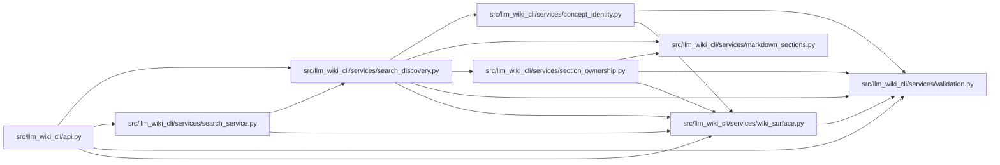

# search_discovery Module

**Path:** `src/llm_wiki_cli/services/search_discovery.py`

## Description

Pure bounded discovery presentation over captured exact page observations.

## Imports

| Source | Symbols |
|--------|---------|
| `.concept_identity` | `validate_locator` |
| `.markdown_sections` | `parse_markdown_document` |
| `.section_ownership` | `observe_page_sections` |
| `.validation` | `is_portable_relative_path` |
| `.wiki_surface` | `canonical_path`, `iter_page_kinds`, `mcp_uri`, `validate_exact_page_coordinate` |
| `__future__` | `annotations` |
| `collections.abc` | `Mapping` |
| `copy` | `deepcopy` |
| `hashlib` | `hashlib` |
| `json` | `json` |
| `re` | `re` |
| `typing` | `Any`, `NoReturn` |

## Local dependency map

<!-- Auto-generated local dependency summary. Do not edit by hand. -->

### Internal neighbors

| Direction | Module |
|---|---|
| Inbound | [api](../modules/api.md) |
| Inbound | [search_service](../modules/search_service.md) |
| Outbound | [concept_identity](../modules/concept_identity.md) |
| Outbound | [markdown_sections](../modules/markdown_sections.md) |
| Outbound | [section_ownership](../modules/section_ownership.md) |
| Outbound | [validation](../modules/validation.md) |
| Outbound | [wiki_surface](../modules/wiki_surface.md) |

## Classes

| Class | Line | Bases | Description |
|-------|------|-------|-------------|
| [DiscoveryError](../entities/DiscoveryError.md) | 33 | `ValueError` | Safe fixed diagnostics without reflecting captured content. |

## Functions

| Function | Signature | Decorators | Description |
|----------|-----------|------------|-------------|
| `_invalid` | `(field: str) -> NoReturn` | — | — |
| `_object` | `(value, field) -> dict[str, Any]` | — | — |
| `_hash` | `(value, field, *, optional = False)` | — | — |
| `_portable_source` | `(value, field)` | — | — |
| `_bounds` | `(value, field) -> dict[str, Any]` | — | — |
| `_native` | `(value) -> dict[str, Any]` | — | — |
| `_reviews` | `(value) -> dict[str, Any]` | — | — |
| `_recorded_review` | `(path: str, reviews) -> dict[str, Any]` | — | — |
| `_native_member` | `(path, native)` | — | — |
| `_basis` | `(concept)` | — | — |
| `_owner` | `(path, mappings, native, concepts)` | — | — |
| `_recorded_source` | `(mapping)` | — | — |
| `_sections` | `(page, locator)` | — | — |
| `enrich_search` | `(result, *, pages_by_path, owner_mappings, native_payload, recorded_reviews) -> dict[str, Any]` | — | Preserve flat candidates; group only exact captured ownership, without I/O. |
