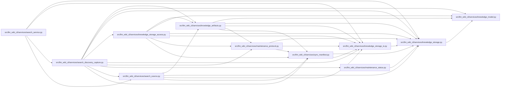

# search_discovery_capture Module

**Path:** `src/llm_wiki_cli/services/search_discovery_capture.py`

## Description

Guarded snapshot inputs for opt-in discovery; no extraction or writes.

## Imports

| Source | Symbols |
|--------|---------|
| `.knowledge_artifacts` | `_decode_json_object` |
| `.knowledge_model` | `parse_knowledge_index` |
| `.knowledge_storage` | `ROOT_FILENAME`, `LOGICAL_SCHEMA`, `MAX_ROOT_BYTES`, `KnowledgeStorageError`, `canonical_bytes`, `digest` |
| `.knowledge_storage_access` | `ScopedKnowledgeRead`, `capture_knowledge_slice` |
| `.knowledge_storage_io` | `StorageReadSession` |
| `.maintenance_protocol` | `ADOPTION_FILENAME`, `MaintenanceProtocolError`, `guard_maintenance_owner` |
| `.maintenance_status` | `build_maintenance_status` |
| `.search_source` | `captured_manifest` |
| `.sync_manifest` | `MANIFEST_FILENAME`, `SyncManifest` |
| `__future__` | `annotations` |
| `dataclasses` | `dataclass` |
| `pathlib` | `Path` |
| `re` | `re` |
| `typing` | `Any` |

## Local dependency map

<!-- Auto-generated local dependency summary. Do not edit by hand. -->

### Internal neighbors

| Direction | Module |
|---|---|
| Inbound | [search_service](../modules/search_service.md) |
| Outbound | [knowledge_artifacts](../modules/knowledge_artifacts.md) |
| Outbound | [knowledge_model](../modules/knowledge_model.md) |
| Outbound | [knowledge_storage](../modules/knowledge_storage.md) |
| Outbound | [knowledge_storage_access](../modules/knowledge_storage_access.md) |
| Outbound | [knowledge_storage_io](../modules/knowledge_storage_io.md) |
| Outbound | [maintenance_protocol](../modules/maintenance_protocol.md) |
| Outbound | [maintenance_status](../modules/maintenance_status.md) |
| Outbound | [search_source](../modules/search_source.md) |
| Outbound | [sync_manifest](../modules/sync_manifest.md) |

## Classes

| Class | Line | Bases | Description |
|-------|------|-------|-------------|
| [DiscoveryCapture](../entities/DiscoveryCapture.md) | 22 | — | — |

## Functions

| Function | Signature | Decorators | Description |
|----------|-----------|------------|-------------|
| `_optional_read` | `(reads, relative, maximum, absent)` | — | — |
| `capture_discovery` | `(wiki_root: Path, reads: StorageReadSession, pages_by_path: dict, *, manifest: SyncManifest \| None = None) -> DiscoveryCapture` | — | Read one adopted owner and one selected native concepts/sections slice. |
