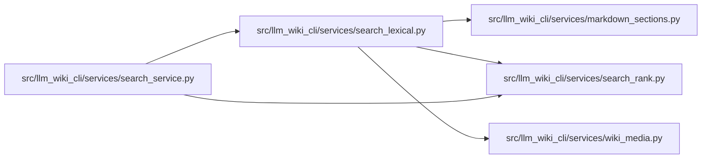

# search_lexical Module

**Path:** `src/llm_wiki_cli/services/search_lexical.py`

## Description

Pure informative lexical discovery; matches never establish source truth.

## Imports

| Source | Symbols |
|--------|---------|
| `.markdown_sections` | `parse_markdown_document`, `semantic_table_key`, `split_table_row` |
| `.search_rank` | `MAX_SEARCH_BYTES`, `MAX_SEARCH_PAGES`, `_tokens` |
| `.wiki_media` | `mask_fenced_code_blocks` |
| `__future__` | `annotations` |
| `collections` | `Counter` |
| `collections.abc` | `Mapping` |
| `copy` | `deepcopy` |
| `hashlib` | `hashlib` |
| `math` | `math` |
| `posixpath` | `posixpath` |
| `re` | `re` |
| `unicodedata` | `unicodedata` |
| `urllib.parse` | `unquote`, `urlsplit` |

## Local dependency map

<!-- Auto-generated local dependency summary. Do not edit by hand. -->

### Internal neighbors

| Direction | Module |
|---|---|
| Inbound | [search_service](../modules/search_service.md) |
| Outbound | [markdown_sections](../modules/markdown_sections.md) |
| Outbound | [search_rank](../modules/search_rank.md) |
| Outbound | [wiki_media](../modules/wiki_media.md) |

## Functions

| Function | Signature | Decorators | Description |
|----------|-----------|------------|-------------|
| `_normal` | `(text)` | — | — |
| `_fields` | `(page)` | — | Disjoint captured spans; child sections do not multiply parent evidence. |
| `_identity_tier` | `(page, needle, definitions)` | — | — |
| `rank_pages` | `(pages, query: str, *, limit = 20, max_pages = MAX_SEARCH_PAGES, max_bytes = MAX_SEARCH_BYTES) -> dict` | — | Rank only supplied captured text within honest, fail-closed work bounds. |
