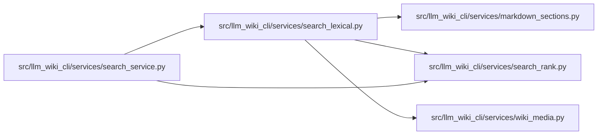

# search_lexical Module

**Path:** `src/llm_wiki_cli/services/search_lexical.py`

## Description

Pure informative lexical discovery; matches never establish source truth.

Discovery tokens use approximate ASCII English word families across captured
text, titles, paths and queries. Literal normalized page identities and actual
defined-symbol checks remain separate and retain precedence. The configuration
identity changes when this matching policy changes; original Markdown spans,
content hashes and section locators continue to describe captured text.

Strong non-identity guide matches can surface one-hop implementation leads from
explicit local links in matched semantic sections. Only uniquely captured
module/entity destinations qualify; fenced examples, external paths, escaping
paths and inventory sections do not supply such evidence. These leads retain
the donor page hash and section locator. A link-only result reports linked
discovery and does not fabricate a target text-match location. Source-augmented
records preserve separate original-wiki and indexed-text hashes. No recursive
lookup, source indexing, execution or truth judgment follows from a link.

Bounded ASCII nominal families are added from captured explanatory sections and
formal definition-table Description cells. For example, normalization can help
discovery for normalizing, and verification for verified. Generated names and
signatures retain their original tokens; defined symbols, paths, URIs and page
identities keep literal precedence. The prose-family configuration identity
records this treatment separately from the unchanged legacy ranker.

These extra discovery tokens do not rewrite indexed Markdown or its content
hash. Returned section locations still cite the original normalized text, and
lexical leads retain their no-live-comparison qualification. The bounded family
rules do not establish semantic equivalence, source correctness or general
language comprehension.

## Imports

| Source | Symbols |
|--------|---------|
| `.markdown_sections` | `parse_markdown_document`, `semantic_table_key`, `split_table_row` |
| `.search_rank` | `MAX_SEARCH_BYTES`, `MAX_SEARCH_PAGES`, `_STOP_WORDS`, `_WORDS` |
| `.wiki_media` | `mask_fenced_code_blocks` |
| `__future__` | `annotations` |
| `collections` | `Counter` |
| `collections.abc` | `Mapping` |
| `copy` | `deepcopy` |
| `hashlib` | `hashlib` |
| `math` | `math` |
| `posixpath` | `posixpath` |
| `re` | `re` |
| `unicodedata` | `unicodedata` |
| `urllib.parse` | `unquote`, `urlsplit` |

## Local dependency map

<!-- Auto-generated local dependency summary. Do not edit by hand. -->

### Internal neighbors

| Direction | Module |
|---|---|
| Inbound | [search_service](../modules/search_service.md) |
| Outbound | [markdown_sections](../modules/markdown_sections.md) |
| Outbound | [search_rank](../modules/search_rank.md) |
| Outbound | [wiki_media](../modules/wiki_media.md) |

## Functions

| Function | Signature | Decorators | Description |
|----------|-----------|------------|-------------|
| `_normal` | `(text)` | — | — |
| `_word_form` | `(word)` | — | Approximate English word families for discovery, never identity matching. |
| `_tokens` | `(text)` | — | — |
| `_prose_aliases` | `(text)` | — | Bounded nominal families in explanatory text, never identifier aliases. |
| `_fields` | `(page)` | — | Disjoint captured spans; child sections do not multiply parent evidence. |
| `_identity_tier` | `(page, needle, definitions)` | — | — |
| `_linked_candidates` | `(documents, strict, terms)` | — | One-hop leads from matched diagnostic prose, never source correctness. |
| `rank_pages` | `(pages, query: str, *, limit = 20, max_pages = MAX_SEARCH_PAGES, max_bytes = MAX_SEARCH_BYTES) -> dict` | — | Rank only supplied captured text within honest, fail-closed work bounds. |