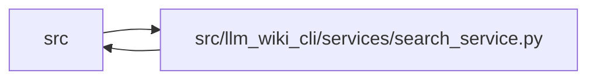

# search_service Module

**Path:** `src/llm_wiki_cli/services/search_service.py`

## Description

Shares wiki page discovery and ranked or substring search across public consumers. Ranking preserves exact identities, reasons, corpus commitments and collection bounds without introducing an MCP dependency into ordinary Python or CLI search.

## Imports

| Source | Symbols |
|--------|---------|
| `.` | `wiki_surface` |
| `..config` | `validate_path`, `validate_source_root` |
| `.documentation_query_builder` | `normalize_documentation_query_limit`, `validate_live_query_source_selection` |
| `.io` | `read_md`, `decode_markdown_bytes` |
| `.knowledge_storage` | `KnowledgeStorageError` |
| `.knowledge_storage_io` | `StorageReadSession` |
| `.search_discovery` | `DiscoveryError`, `enrich_search` |
| `.search_discovery_capture` | `capture_discovery` |
| `.search_lexical` | `rank_pages` |
| `.search_rank` | `MAX_SEARCH_BYTES`, `MAX_SEARCH_PAGES`, `rank_pages` |
| `.search_source` | `MAX_SOURCE_INDEX_BYTES`, `capture_source_index`, `captured_manifest`, `source_page_selected` |
| `.source_selection` | `resolve_source_selection`, `path_is_selected`, `validate_persisted_source_selection_identity` |
| `.source_snapshot` | `build_source_snapshot`, `capture_source_selection_inputs`, `source_snapshot_matches_current_files` |
| `.workflow_profile` | `canonical_json` |
| `__future__` | `annotations` |
| `collections.abc` | `Callable`, `Iterable` |
| `pathlib` | `Path` |
| `re` | `re` |
| `typing` | `Any` |

## Local dependency map

<!-- Auto-generated local dependency summary. Do not edit by hand. -->

> Module-level dependencies exceed the generated-diagram limits, so the diagram and table below group them by top-level package. Counts report the number of module neighbors in each package.

### Internal neighbors

| Direction | Module |
|---|---|
| Inbound | `src` (2) |
| Outbound | `src` (14) |

> All 16 module neighbor(s) are summarized by package because the module-level view exceeds the 12-node limit.

## Functions

| Function | Signature | Decorators | Description |
|----------|-----------|------------|-------------|
| `normalize_search` | `(query: object, kinds: object, limit: object, mode: object)` | — | Validate before discovering source or wiki inputs. |
| `search_records` | `(records: Iterable[dict[str, Any]], query: str, *, limit: int, mode: str)` | — | Apply the same ranking and legacy substring contracts to captured pages. |
| `page_records` | `(wiki_root: Path, kinds: set[str], *, reader: Callable = read_md, eligible: Callable \| None = None)` | — | — |
| `normalize_discovery` | `(discovery)` | — | — |
| `search_wiki` | `(query, *, src_dir = '.', wiki_dir = 'docs/llm_wiki', kinds = None, limit = 20, mode = 'ranked', source_selection = None, allow_external_src = False, include_source = False, reader = read_md, discovery = None)` | — | — |
| `search_prevalidated_roots` | `(query, *, source_root: Path, wiki_root: Path, kinds = None, limit = 20, mode = 'ranked', source_selection = None, include_source = False, reader = read_md, discovery = None)` | — | Share capture/ranking while preserving trusted MCP configured-root boundaries. |
| `_page_membership` | `(wiki_root: Path, kinds: set[str]) -> tuple[str, ...]` | — | — |