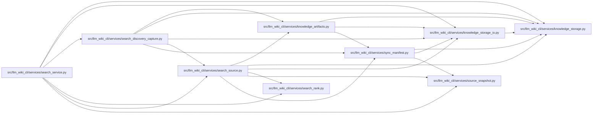

# search_source Module

**Path:** `src/llm_wiki_cli/services/search_source.py`

## Description

Explicit bounded static-source text indexing for canonical module candidates.

## Imports

| Source | Symbols |
|--------|---------|
| `.knowledge_artifacts` | `_decode_json_object` |
| `.knowledge_storage` | `MAX_EXPANDED_BYTES` |
| `.knowledge_storage_io` | `StorageReadSession` |
| `.search_rank` | `MAX_SEARCH_BYTES`, `MAX_SEARCH_PAGES` |
| `.source_snapshot` | `SourceSnapshot` |
| `.sync_manifest` | `MANIFEST_FILENAME`, `SyncManifest` |
| `__future__` | `annotations` |
| `collections.abc` | `Iterable`, `Mapping` |
| `hashlib` | `hashlib` |
| `re` | `re` |
| `typing` | `Any` |

## Local dependency map

<!-- Auto-generated local dependency summary. Do not edit by hand. -->

### Internal neighbors

| Direction | Module |
|---|---|
| Inbound | [search_discovery_capture](../modules/search_discovery_capture.md) |
| Inbound | [search_service](../modules/search_service.md) |
| Outbound | [knowledge_artifacts](../modules/knowledge_artifacts.md) |
| Outbound | [knowledge_storage](../modules/knowledge_storage.md) |
| Outbound | [knowledge_storage_io](../modules/knowledge_storage_io.md) |
| Outbound | [search_rank](../modules/search_rank.md) |
| Outbound | [source_snapshot](../modules/source_snapshot.md) |
| Outbound | [sync_manifest](../modules/sync_manifest.md) |

## Functions

| Function | Signature | Decorators | Description |
|----------|-----------|------------|-------------|
| `augment_module_page` | `(page: Mapping[str, Any], source_path: str, raw: bytes) -> dict[str, Any]` | — | Preserve wiki identity separately from the derived searchable text. |
| `capture_source_index` | `(pages: Iterable[dict[str, Any]], snapshot: SourceSnapshot, wiki_reads: StorageReadSession, source_reads: StorageReadSession, *, manifest: SyncManifest \| None = None) -> tuple[list[dict[str, Any]], dict[str, Any]]` | — | Index only manifest-owned module sources inside the captured live boundary. |
| `captured_manifest` | `(reads: StorageReadSession) -> SyncManifest` | — | — |
| `source_page_selected` | `(path: str, snapshot: SourceSnapshot, manifest: SyncManifest) -> bool` | — | — |
