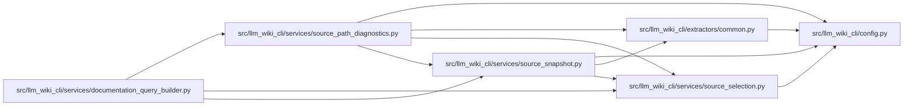

# source_path_diagnostics Module

**Path:** `src/llm_wiki_cli/services/source_path_diagnostics.py`

## Description

Supplied-path facts derived from captured discovery policy and extraction.

## Imports

| Source | Symbols |
|--------|---------|
| `..config` | `EXCLUDED_DIRS`, `GitIgnoreMatcher`, `PathValidationError`, `is_agent_worktree_path` |
| `..extractors.common` | `is_bundled_helper_implementation_path`, `is_generated_javascript_bundle_path` |
| `.source_selection` | `path_is_selected` |
| `.source_snapshot` | `SourceSnapshot`, `_language_for_path`, `_is_rescuable_typescript_src_lib_file` |
| `__future__` | `annotations` |
| `pathlib` | `Path` |
| `stat` | `stat` |

## Local dependency map

<!-- Auto-generated local dependency summary. Do not edit by hand. -->

### Internal neighbors

| Direction | Module |
|---|---|
| Inbound | [documentation_query_builder](../modules/documentation_query_builder.md) |
| Outbound | [config](../modules/config.md) |
| Outbound | [common](../modules/common.md) |
| Outbound | [source_selection](../modules/source_selection.md) |
| Outbound | [source_snapshot](../modules/source_snapshot.md) |

## Functions

| Function | Signature | Decorators | Description |
|----------|-----------|------------|-------------|
| `source_path_diagnostics` | `(snapshot: SourceSnapshot, paths: tuple[str, ...]) -> dict[str, dict]` | — | Observe selected path metadata without following links or reading content. |
