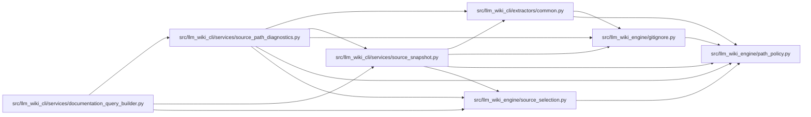

# source_path_diagnostics Module

**Path:** `src/llm_wiki_cli/services/source_path_diagnostics.py`

## Description

Separates supplied-path filesystem observations from captured discovery
eligibility. Source-selection exclusions prevent a metadata read; other
exclusions preserve the permitted no-follow filesystem observation. Recognized
Go test files excluded by the default language policy report
`go-tests-excluded` and `not-attempted`, rather than an unsupported extension.
Included source files without an attributable extraction outcome remain
unavailable until the query builder merges an extractor-owned result. Inventory
absence cannot establish a missing file, parser failure or completed extraction.

## Imports

| Source | Symbols |
|--------|---------|
| `..extractors.common` | `is_bundled_helper_implementation_path`, `is_generated_javascript_bundle_path` |
| `.source_snapshot` | `SourceSnapshot`, `_language_selection_for_path`, `_is_rescuable_typescript_src_lib_file` |
| `__future__` | `annotations` |
| `llm_wiki_engine.gitignore` | `GitIgnoreMatcher` |
| `llm_wiki_engine.path_policy` | `EXCLUDED_DIRS`, `PathValidationError`, `is_agent_worktree_path` |
| `llm_wiki_engine.source_selection` | `path_is_selected` |
| `pathlib` | `Path` |
| `stat` | `stat` |

## Local dependency map

<!-- Auto-generated local dependency summary. Do not edit by hand. -->

### Internal neighbors

| Direction | Module |
|---|---|
| Inbound | [documentation_query_builder](../modules/documentation_query_builder.md) |
| Outbound | [common](../modules/common.md) |
| Outbound | [source_snapshot](../modules/source_snapshot.md) |
| Outbound | [gitignore](../modules/gitignore.md) |
| Outbound | [path_policy](../modules/path_policy.md) |
| Outbound | [source_selection](../modules/source_selection.md) |

## Functions

| Function | Signature | Decorators | Description |
|----------|-----------|------------|-------------|
| `source_path_diagnostics` | `(snapshot: SourceSnapshot, paths: tuple[str, ...]) -> dict[str, dict]` | — | Observe selected path metadata without following links or reading content. |
