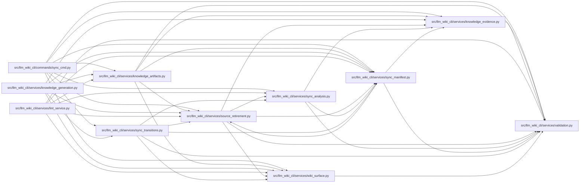

# source_retirement Module

**Path:** `src/llm_wiki_cli/services/source_retirement.py`

## Description

Source-owned member retirement, separate from authored concept lifecycle.

Retirement authority comes from exact persisted source coordinates and current
selected inventory, not Markdown headers or filename guesses. The machine
`entity_retirement` record binds canonical entity paths to historical owners and
tombstones. A member that disappears from a still-documentable source keeps its
page and authored content; native reads expose `llm-wiki/source-retirement`.
Known historical evidence stays historical, and unknown provenance is not
upgraded. This observation never authors human reviews or concept lifecycle.

Retained generated defaults support attribution when the exact owner revives.
Current generated descriptions can update while authored descriptions, cells and
custom context survive. Duplicate suffix removal requires a distinguishable,
unchanged surviving prefix under recorded defaults and full entity observations;
ambiguous shifts stop before writes. Captured sources without documentable
inventory remain an explicit parser/coverage/empty-module gap.

## Imports

| Source | Symbols |
|--------|---------|
| `.knowledge_evidence` | `entity_observation_hash` |
| `.sync_analysis` | `_recorded_entity_pages` |
| `.sync_manifest` | `ManifestPageSource`, `SyncManifest`, `SyncManifestError`, `generated_semantics_for_file` |
| `.validation` | `portable_path_key` |
| `.wiki_surface` | `PageKind`, `WikiSurfaceError`, `canonical_path` |
| `__future__` | `annotations` |
| `collections` | `Counter` |
| `collections.abc` | `Mapping` |
| `pathlib` | `PurePosixPath` |

## Local dependency map

<!-- Auto-generated local dependency summary. Do not edit by hand. -->

### Internal neighbors

| Direction | Module |
|---|---|
| Inbound | [sync_cmd](../modules/sync_cmd.md) |
| Inbound | [knowledge_artifacts](../modules/knowledge_artifacts.md) |
| Inbound | [knowledge_generation](../modules/knowledge_generation.md) |
| Inbound | [lint_service](../modules/lint_service.md) |
| Inbound | [sync_manifest](../modules/sync_manifest.md) |
| Inbound | [sync_transitions](../modules/sync_transitions.md) |
| Outbound | [knowledge_evidence](../modules/knowledge_evidence.md) |
| Outbound | [sync_analysis](../modules/sync_analysis.md) |
| Outbound | [sync_manifest](../modules/sync_manifest.md) |
| Outbound | [validation](../modules/validation.md) |
| Outbound | [wiki_surface](../modules/wiki_surface.md) |

## Classes

| Class | Line | Bases | Description |
|-------|------|-------|-------------|
| [SourceRetirementError](../entities/SourceRetirementError.md) | 23 | `ValueError` | A retirement record cannot be reconciled with authoritative ownership. |

## Functions

| Function | Signature | Decorators | Description |
|----------|-----------|------------|-------------|
| `read_entity_retirement_state` | `(generation_inputs: Mapping[str, object]) -> dict[str, ManifestPageSource]` | — | Decode exact machine records without deriving ownership from Markdown. |
| `entity_owner_present` | `(owner: ManifestPageSource, sources: Mapping[str, Mapping]) -> bool` | — | Compare the exact declaration occurrence with captured source membership. |
| `retired_entity_mappings` | `(manifest: SyncManifest) -> dict[str, ManifestPageSource]` | — | Validate committed retirements against mappings and historical tombstones. |
| `with_entity_retirement_state` | `(generation_inputs: Mapping[str, object], mappings: Mapping[str, ManifestPageSource], *, generated_semantics: Mapping[str, dict] \| None = None) -> dict[str, object]` | — | Retain the planned coordinates without minting evidence or lifecycle. |
| `historical_entity_semantics` | `(manifest: SyncManifest, owner: ManifestPageSource) -> dict \| None` | — | Return recorded generated defaults for attribution when the owner revives. |
| `discover_retired_entities` | `(manifest: SyncManifest, inventory: Mapping[str, Mapping]) -> dict[str, ManifestPageSource]` | — | Plan fresh removals and recover exact persisted, previously unmarked owners. |
| `_check_duplicate_removal_custody` | `(manifest, inventory, recorded) -> None` | — | Require an unchanged, distinguishable surviving prefix before retiring suffixes. |
