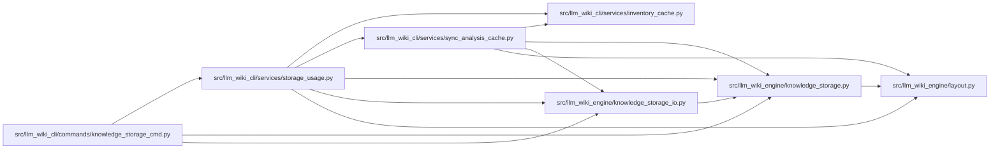

# storage_usage Module

**Path:** `src/llm_wiki_cli/services/storage_usage.py`

## Description

Report the disk space llm-wiki owns for one wiki and reclaim it on request.

## Imports

| Source | Symbols |
|--------|---------|
| `.inventory_cache` | `CACHE_FILENAME`, `ENV_CACHE_DIR` |
| `.sync_analysis_cache` | `FILENAME` |
| `__future__` | `annotations` |
| `hashlib` | `hashlib` |
| `llm_wiki_engine.knowledge_storage` | `KnowledgeStorageError` |
| `llm_wiki_engine.knowledge_storage_io` | `_absolute_path` |
| `llm_wiki_engine.layout` | `DEFAULT_LAYOUT` |
| `os` | `os` |
| `pathlib` | `Path` |
| `shutil` | `shutil` |
| `subprocess` | `subprocess` |
| `tempfile` | `tempfile` |
| `time` | `time` |
| `typing` | `Any` |

## Local dependency map

<!-- Auto-generated local dependency summary. Do not edit by hand. -->

### Internal neighbors

| Direction | Module |
|---|---|
| Inbound | [knowledge_storage_cmd](../modules/knowledge_storage_cmd.md) |
| Outbound | [inventory_cache](../modules/inventory_cache.md) |
| Outbound | [sync_analysis_cache](../modules/sync_analysis_cache.md) |
| Outbound | [knowledge_storage](../modules/knowledge_storage.md) |
| Outbound | [knowledge_storage_io](../modules/knowledge_storage_io.md) |
| Outbound | [layout](../modules/layout.md) |

## Functions

| Function | Signature | Decorators | Description |
|----------|-----------|------------|-------------|
| `_measure` | `(path: Path, budget: list[int]) -> tuple[int, int]` | — | Return (bytes, files) below ``path`` without following symbolic links. |
| `_git_directories` | `(wiki: Path) -> list[Path]` | — | Return this checkout's Git directory and, for a worktree, the shared one. |
| `_candidates` | `(wiki: Path) -> list[tuple[str, Path]]` | — | — |
| `_aged_entries` | `(kind: str, path: Path, deadline: float) -> list[Path]` | — | Return what an aged class may remove: whole runs last changed before the deadline. |
| `_remove` | `(path: Path) -> None` | — | — |
| `storage_usage` | `(wiki_dir: str \| Path, *, reclaim: list[str] \| tuple[str, ...] = (), older_than_days: int = DEFAULT_RECOVERY_AGE_DAYS, apply: bool = False) -> dict[str, Any]` | — | List every location llm-wiki owns for ``wiki_dir`` and optionally reclaim some. |
