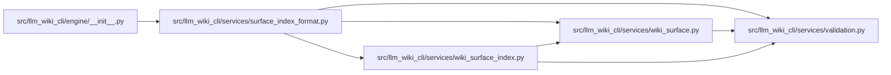

# surface_index_format Module

**Path:** `src/llm_wiki_cli/services/surface_index_format.py`

## Description

Format checks for the ``llm-wiki-surface-index/v1`` wiki surface index.

The surface index (``.llm-wiki-surface.json``) lists every canonical wiki
page with its kind, coordinates, source file and internal links, plus page
counts, media assets and user-flow entry points. These checks read no wiki or
source files: they confirm a decoded index is internally consistent with the
canonical page registry. ``source_hash`` commits the source inventory, which
the index does not carry, so only its shape is checked.

## Imports

| Source | Symbols |
|--------|---------|
| `.validation` | `SharedValidationError`, `require_portable_relative_path` |
| `.wiki_surface` | `WikiSurfaceError`, `canonical_path`, `is_safe_page_id`, `iter_page_kinds`, `mcp_uri` |
| `.wiki_surface_index` | `SURFACE_INDEX_FILENAME`, `WIKI_SURFACE_INDEX_SCHEMA_VERSION` |
| `__future__` | `annotations` |
| `collections.abc` | `Mapping`, `Sequence` |
| `re` | `re` |
| `typing` | `Any` |

## Local dependency map

<!-- Auto-generated local dependency summary. Do not edit by hand. -->

### Internal neighbors

| Direction | Module |
|---|---|
| Inbound | [engine___init__](../modules/engine___init__.md) |
| Outbound | [validation](../modules/validation.md) |
| Outbound | [wiki_surface](../modules/wiki_surface.md) |
| Outbound | [wiki_surface_index](../modules/wiki_surface_index.md) |

## Classes

| Class | Line | Bases | Description |
|-------|------|-------|-------------|
| [SurfaceIndexError](../entities/SurfaceIndexError.md) | 58 | `ValueError` | A surface index does not follow its format. |

## Functions

| Function | Signature | Decorators | Description |
|----------|-----------|------------|-------------|
| `validate_surface_index` | `(document: object) -> None` | — | Raise ``SurfaceIndexError`` unless *document* is a valid surface index. |
| `_pages` | `(value: object) -> dict[str, Mapping[str, Any]]` | — | — |
| `_counts` | `(value: object, pages: Mapping[str, Mapping[str, Any]]) -> dict[str, int]` | — | — |
| `_dependency_pages` | `(value: object, by_kind: Mapping[str, int], count: int) -> None` | — | — |
| `_assets` | `(value: object, counts: Mapping[str, Any], page_paths: set[str]) -> None` | — | — |
| `_flows` | `(value: object, flow_pages: set[str]) -> None` | — | — |
| `_sorted_unique` | `(values: Sequence[str], field: str) -> None` | — | — |
| `_asset_path` | `(value: str, field: str) -> None` | — | — |
| `_portable` | `(value: object, field: str) -> None` | — | — |
| `_canonical_portable_path` | `(value: object) -> str \| None` | — | — |
| `_count` | `(value: object, field: str) -> int` | — | — |
| `_strings` | `(value: object, field: str) -> list[str]` | — | — |
| `_list` | `(value: object, field: str) -> list[Any]` | — | — |
| `_object` | `(value: object, field: str) -> Mapping[str, Any]` | — | — |
| `_exact` | `(value: Mapping[str, Any], required: set[str] \| frozenset[str], optional: set[str] \| frozenset[str], field: str) -> None` | — | — |
