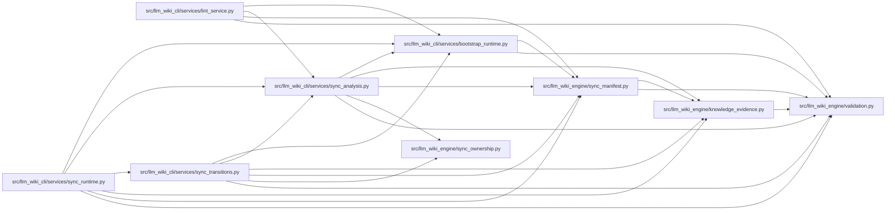

# sync_analysis Module

**Path:** `src/llm_wiki_cli/services/sync_analysis.py`

## Description

Read-only source/manifest diff analysis shared by sync and lint.

## Imports

| Source | Symbols |
|--------|---------|
| `.bootstrap_runtime` | `_module_name_from_path`, `_page_name_for_entity`, `_page_name_for_module`, `build_entity_occurrence_page_map`, `build_entity_page_map`, `build_module_page_map` |
| `__future__` | `annotations` |
| `collections` | `Counter`, `defaultdict` |
| `dataclasses` | `dataclass`, `field` |
| `llm_wiki_engine.knowledge_evidence` | `hash_file`, `semantic_hash_for_file` |
| `llm_wiki_engine.sync_manifest` | `ManifestPageSource`, `SyncManifest` |
| `llm_wiki_engine.sync_ownership` | `SyncOwnershipError` |
| `llm_wiki_engine.validation` | `is_portable_path_component`, `portable_path_key` |
| `pathlib` | `Path` |
| `typing` | `Mapping` |

## Local dependency map

<!-- Auto-generated local dependency summary. Do not edit by hand. -->

### Internal neighbors

| Direction | Module |
|---|---|
| Inbound | [lint_service](../modules/lint_service.md) |
| Inbound | [sync_runtime](../modules/sync_runtime.md) |
| Inbound | [sync_transitions](../modules/sync_transitions.md) |
| Outbound | [bootstrap_runtime](../modules/bootstrap_runtime.md) |
| Outbound | [knowledge_evidence](../modules/knowledge_evidence.md) |
| Outbound | [sync_manifest](../modules/sync_manifest.md) |
| Outbound | [sync_ownership](../modules/sync_ownership.md) |
| Outbound | [validation](../modules/validation.md) |

## Classes

| Class | Line | Bases | Description |
|-------|------|-------|-------------|
| [_RecordedEntityPages](../entities/RecordedEntityPages.md) | 43 | — | — |
| [SyncDiff](../entities/SyncDiff.md) | 135 | — | Categorised difference between a persisted manifest and live inventory. |

## Functions

| Function | Signature | Decorators | Description |
|----------|-----------|------------|-------------|
| `_ownership_error` | `(owner: EntityOwner, reason: str) -> SyncOwnershipError` | — | — |
| `_validated_recorded_page` | `(owner: EntityOwner, page: object) -> str` | — | — |
| `_recorded_entity_pages` | `(manifest: SyncManifest) -> _RecordedEntityPages` | — | Reconcile explicit ownership before considering any legacy fallback. |
| `compute_sync_diff` | `(manifest: SyncManifest, inventory: dict, src_dir: str, *, entity_page_cache: dict[tuple[str, str], str] \| None = None, module_page_map: dict[str, str] \| None = None, source_content_hashes: Mapping[str, str] \| None = None) -> SyncDiff` | — | Compare a managed manifest with one live structural inventory. |
