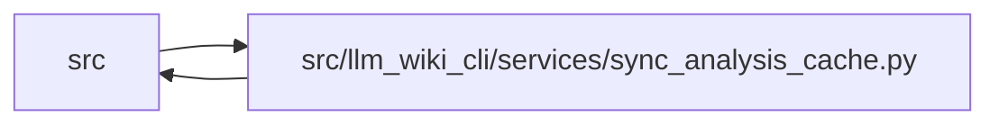

# sync_analysis_cache Module

**Path:** `src/llm_wiki_cli/services/sync_analysis_cache.py`

## Description

An optional, bounded cache of static sync inputs authenticated by a validated
complete knowledge commit. Version 2 records its reuse level in both the payload
and committed metadata. Full coverage retains raw graph observations; inventory
coverage retains inventory, page maps, detector inputs, implementation observations
and the complete extraction sidecars, while explicitly omitting graph observations.
Unavailable sidecars remain unavailable rather than becoming complete-empty data.

Capture first considers full coverage, then inventory coverage when graph data
exceeds the budget. The complete selected payload must fit the unchanged 64 MiB
physical and decoded JSON limit. Compact UTF-8 JSON is uncompressed; bounded
counting does not retain an oversized encoding. Full captures own an independent
graph copy. Older cache schemas use ordinary generation until an eligible owning
commit captures the current version.

Reuse binds exact source bytes, selection/ignore policy, generation configuration,
installed implementation and prepared-helper identities. Generated wiki structure
is checked separately from semantic edits. Partial hits feed their exact sidecars
to the ordinary graph builders and typed materializer; no omitted graph data is
reported as zero or complete. Source, wiki and provider mutations reject matched
reuse. Fixed capture reasons and byte counts expose ineligible contexts and budget
failures. Cache saving follows successful owning publication and remains advisory.

## Imports

| Source | Symbols |
|--------|---------|
| `..config` | `EXTRACTOR_REGISTRY` |
| `.analysis_capture` | `capture_analysis`, `capture_operation` |
| `.contracts` | `SECTION_OWNERSHIP_EXTENSION_KEY` |
| `.extraction_service` | `InventoryResult`, `ExtractorStatus` |
| `.inventory_cache` | `InventoryCacheStats`, `prepare_cache_options` |
| `.io` | `first_unsafe_path_component`, `write_bytes_atomic` |
| `.knowledge_envelope` | `hash_inventory`, `INVENTORY_HASH_EXTENSION` |
| `.knowledge_evidence` | `canonical_json_bytes`, `hash_json`, `sha256_bytes` |
| `.knowledge_generation` | `_graph_concepts` |
| `.knowledge_reuse` | `implementation_hash`, `REUSE_INPUT_KEY` |
| `.knowledge_storage` | `KnowledgeStorageError` |
| `.knowledge_storage_io` | `read_guarded` |
| `.progress` | `observed_phase`, `record_counts` |
| `.runtime_output` | `warn` |
| `.section_ownership` | `observe_page_sections` |
| `__future__` | `annotations` |
| `collections.abc` | `Mapping` |
| `dataclasses` | `asdict`, `fields` |
| `json` | `json` |
| `pathlib` | `Path` |

## Local dependency map

<!-- Auto-generated local dependency summary. Do not edit by hand. -->

> Module-level dependencies exceed the generated-diagram limits, so the diagram and table below group them by top-level package. Counts report the number of module neighbors in each package.

### Internal neighbors

| Direction | Module |
|---|---|
| Inbound | `src` (3) |
| Outbound | `src` (15) |

> All 17 module neighbor(s) are summarized by package because the module-level view exceeds the 12-node limit.

## Classes

| Class | Line | Bases | Description |
|-------|------|-------|-------------|
| [SyncAnalysisMutationError](../entities/SyncAnalysisMutationError.md) | 25 | `ValueError` | A matched static-input snapshot changed before publication. |

## Functions

| Function | Signature | Decorators | Description |
|----------|-----------|------------|-------------|
| `input_key` | `(options, snapshot, manifest, generation_inputs, *, explain = False)` | `@capture_operation` | Bind source bytes, policy, schema, producer, helpers and generation options. |
| `cache_destination` | `(options)` | — | Return the bounded eligibility label independently of capture content. |
| `cache_path` | `(options)` | — | — |
| `report_capture` | `(options, status, reason, *, payload_bytes = None, over_budget = False)` | — | Emit fixed vocabulary and counts, never source content or unbounded paths. |
| `payload_size` | `(payload)` | — | Count the exact writer encoding up to the budget, without retaining it. |
| `load` | `(options, snapshot, manifest, generation_inputs, state)` | `@observed_phase('sync_analysis_reuse')` | A cache is advisory; only exact prior committed content authorizes reuse. |
| `build_payload` | `(options, prepared, surface)` | — | — |
| `commitment` | `(payload)` | — | — |
| `generated_sections_match` | `(root, artifacts)` | — | Allow prose edits; changing generated structure requires the ordinary path. |
| `save` | `(options, payload)` | — | — |
| `inventory_result` | `(payload, snapshot, options)` | — | — |