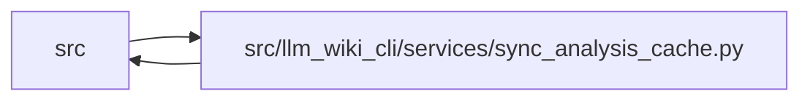

# sync_analysis_cache Module

**Path:** `src/llm_wiki_cli/services/sync_analysis_cache.py`

## Description

An optional, bounded cache of static sync analysis whose exact payload is bound
to a validated complete knowledge commit. Reuse requires matching source bytes,
selection and ignore policy, generation configuration, installed implementation
and prepared-helper identities. Guarded reads compare generated wiki structure;
semantic edits remain eligible while structural drift uses ordinary analysis.
Source, wiki and provider changes during a matched run reject reuse. Cache data
is saved only after successful artifact publication, and unavailable or corrupt
cache data never replaces a required write or validation.

## Imports

| Source | Symbols |
|--------|---------|
| `..config` | `EXTRACTOR_REGISTRY` |
| `.analysis_capture` | `capture_analysis`, `capture_operation` |
| `.contracts` | `SECTION_OWNERSHIP_EXTENSION_KEY` |
| `.extraction_service` | `InventoryResult`, `ExtractorStatus` |
| `.inventory_cache` | `InventoryCacheStats`, `prepare_cache_options` |
| `.io` | `first_unsafe_path_component`, `write_json_atomic` |
| `.knowledge_envelope` | `hash_inventory`, `INVENTORY_HASH_EXTENSION` |
| `.knowledge_evidence` | `hash_json`, `formatted_json_bytes`, `sha256_bytes` |
| `.knowledge_generation` | `_graph_concepts` |
| `.knowledge_reuse` | `implementation_hash`, `REUSE_INPUT_KEY` |
| `.knowledge_storage` | `KnowledgeStorageError` |
| `.knowledge_storage_io` | `read_guarded` |
| `.progress` | `observed_phase`, `record_counts` |
| `.runtime_output` | `warn` |
| `.section_ownership` | `observe_page_sections` |
| `__future__` | `annotations` |
| `collections.abc` | `Mapping` |
| `dataclasses` | `asdict` |
| `json` | `json` |
| `pathlib` | `Path` |

## Local dependency map

<!-- Auto-generated local dependency summary. Do not edit by hand. -->

> Module-level dependencies exceed the generated-diagram limits, so the diagram and table below group them by top-level package. Counts report the number of module neighbors in each package.

### Internal neighbors

| Direction | Module |
|---|---|
| Inbound | `src` (2) |
| Outbound | `src` (15) |

> All 16 module neighbor(s) are summarized by package because the module-level view exceeds the 12-node limit.

## Classes

| Class | Line | Bases | Description |
|-------|------|-------|-------------|
| [SyncAnalysisMutationError](../entities/SyncAnalysisMutationError.md) | 25 | `ValueError` | A matched static-input snapshot changed before publication. |

## Functions

| Function | Signature | Decorators | Description |
|----------|-----------|------------|-------------|
| `input_key` | `(options, snapshot, manifest, generation_inputs)` | `@capture_operation` | Bind source bytes, policy, schema, producer, helpers and generation options. |
| `cache_path` | `(options)` | — | — |
| `load` | `(options, snapshot, manifest, generation_inputs, state)` | `@observed_phase('sync_analysis_reuse')` | A cache is advisory; only exact prior committed content authorizes reuse. |
| `build_payload` | `(options, prepared, surface)` | — | — |
| `commitment` | `(payload)` | — | — |
| `generated_sections_match` | `(root, artifacts)` | — | Allow prose edits; changing generated structure requires the ordinary path. |
| `save` | `(options, payload)` | — | — |
| `inventory_result` | `(payload, snapshot, options)` | — | — |
