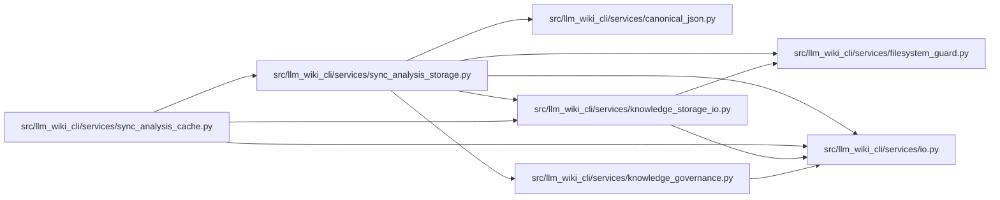

# sync_analysis_storage Module

**Path:** `src/llm_wiki_cli/services/sync_analysis_storage.py`

## Description

Bounded content-addressed persistence for advisory sync analysis captures.

## Imports

| Source | Symbols |
|--------|---------|
| `.canonical_json` | `canonical_chunks` |
| `.filesystem_guard` | `atomic_write_guarded_bytes`, `ensure_guarded_directory`, `fresh_no_follow_stat`, `remove_guarded_tree`, `unlink_guarded_bytes` |
| `.io` | `first_unsafe_path_component`, `write_bytes_atomic` |
| `.knowledge_governance` | `governance_lock` |
| `.knowledge_storage_io` | `read_guarded` |
| `__future__` | `annotations` |
| `hashlib` | `hashlib` |
| `json` | `json` |
| `pathlib` | `Path` |
| `re` | `re` |
| `typing` | `Any` |

## Local dependency map

<!-- Auto-generated local dependency summary. Do not edit by hand. -->

### Internal neighbors

| Direction | Module |
|---|---|
| Inbound | [sync_analysis_cache](../modules/sync_analysis_cache.md) |
| Outbound | [canonical_json](../modules/canonical_json.md) |
| Outbound | [filesystem_guard](../modules/filesystem_guard.md) |
| Outbound | [io](../modules/io.md) |
| Outbound | [knowledge_governance](../modules/knowledge_governance.md) |
| Outbound | [knowledge_storage_io](../modules/knowledge_storage_io.md) |

## Functions

| Function | Signature | Decorators | Description |
|----------|-----------|------------|-------------|
| `_decode_json` | `(raw)` | — | — |
| `_container_children` | `(node, *, parts)` | — | — |
| `measure` | `(payload, maximum)` | — | Hash the existing canonical encoding without allocating a whole capture. |
| `_small_bytes` | `(value, maximum)` | — | — |
| `_objects` | `(path)` | — | — |
| `_pending` | `(path)` | — | — |
| `_pending_owner_bytes` | `(path)` | — | — |
| `_current_root` | `(path, maximum)` | — | — |
| `_root_shards` | `(raw)` | — | — |
| `_pending_records` | `(path)` | — | — |
| `_prepare_pending` | `(path)` | — | — |
| `_record_pending` | `(path, records, logical_hash, size)` | — | — |
| `_recover_pending` | `(path, root_limit)` | — | — |
| `_previous_shards` | `(path, root_limit)` | — | — |
| `_remove_superseded_shards` | `(path, published, references, root_limit)` | — | — |
| `_journal_superseded` | `(path, references, owned = None)` | — | — |
| `save` | `(path: Path, payload, *, root_limit: int, total_limit: int, writer = write_bytes_atomic)` | — | Publish all immutable shards before atomically replacing their catalog. |
| `_save_locked` | `(path: Path, payload, *, root_limit: int, total_limit: int, writer)` | — | — |
| `load` | `(path: Path, *, root_limit: int, total_limit: int) -> Any` | — | Read legacy captures or verify every bounded subtree before reuse. |
