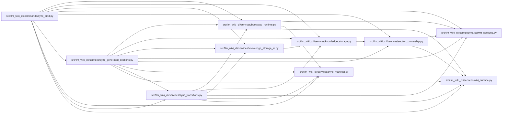

# sync_generated_sections Module

**Path:** `src/llm_wiki_cli/services/sync_generated_sections.py`

## Description

Read-only preflight for source-derived generated sections in retained, uniquely
owned module and entity pages. Expectations come from the active ordinary
renderer and selected live inventory, independently of previously committed wiki
structure. This permits repair even when an older sync committed an altered
member table. Graph-derived relationship and dependency sections remain with
their existing owners.

Repairs replace only the affected generated section extents and restore missing
source-derived sections. Uniquely attributable Description cells are preserved;
Description, Notes, unknown custom sections and unaffected page text retain their
ownership. Duplicate headings or ambiguous orphan/duplicate Description cells
produce an explicit preflight failure instead of guessed attribution.

Verified retained-page plans carry exact originals into the existing guarded
transition executor. Source bytes remain unchanged. Mutation refuses publication;
interrupted publication retains verified recovery data and blocks retry until
that recovery is explicitly resolved. Source selection and page ownership are
checked before a repair can become output work.

## Imports

| Source | Symbols |
|--------|---------|
| `.bootstrap_runtime` | `_generate_entity_md`, `_generate_module_md` |
| `.knowledge_storage` | `MAX_EXPANDED_BYTES`, `KnowledgeStorageError` |
| `.knowledge_storage_io` | `StorageReadSession` |
| `.markdown_sections` | `description_table_cells`, `is_placeholder_description`, `mixed_table_projection`, `normalize_markdown`, `parse_markdown_document`, `preserve_table_description_cells` |
| `.section_ownership` | `observe_page_sections`, `SectionOwnership` |
| `.sync_manifest` | `ManifestPageSource` |
| `.sync_transitions` | `PageTransitionError`, `PageTransitionPlan`, `RetainedPageRepair` |
| `.wiki_surface` | `PageKind` |
| `__future__` | `annotations` |
| `collections` | `Counter` |
| `dataclasses` | `replace` |
| `pathlib` | `Path` |
| `typing` | `Mapping` |

## Local dependency map

<!-- Auto-generated local dependency summary. Do not edit by hand. -->

### Internal neighbors

| Direction | Module |
|---|---|
| Inbound | [sync_cmd](../modules/sync_cmd.md) |
| Outbound | [bootstrap_runtime](../modules/bootstrap_runtime.md) |
| Outbound | [knowledge_storage](../modules/knowledge_storage.md) |
| Outbound | [knowledge_storage_io](../modules/knowledge_storage_io.md) |
| Outbound | [markdown_sections](../modules/markdown_sections.md) |
| Outbound | [section_ownership](../modules/section_ownership.md) |
| Outbound | [sync_manifest](../modules/sync_manifest.md) |
| Outbound | [sync_transitions](../modules/sync_transitions.md) |
| Outbound | [wiki_surface](../modules/wiki_surface.md) |

## Functions

| Function | Signature | Decorators | Description |
|----------|-----------|------------|-------------|
| `_sections` | `(markdown, kind)` | — | — |
| `_structural` | `(section, ownership)` | — | — |
| `_preserve_cells` | `(current, generated, path)` | — | Reject ambiguous attribution instead of using last-duplicate-wins. |
| `repair_source_sections` | `(existing: str, generated: str, kind: PageKind, path: str) -> str` | — | Replace only source-derived generated projections, retaining other text. |
| `_source_markdown` | `(owner, inventory, module_pages, entity_pages, module_renderer, entity_renderer)` | — | — |
| `plan_generated_source_repairs` | `(wiki_dir: Path, plan: PageTransitionPlan, inventory: Mapping, module_pages: Mapping, entity_pages: Mapping, *, module_renderer = _generate_module_md, entity_renderer = _generate_entity_md) -> tuple[PageTransitionPlan, dict[str, ManifestPageSource]]` | — | Preflight all retained owners and semantic attribution before any write. |
