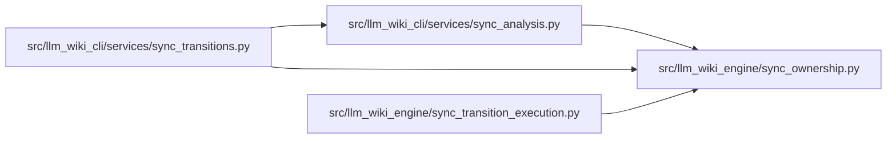

# sync_ownership Module

**Path:** `src/llm_wiki_engine/sync_ownership.py`

## Description

Errors raised when a sync cannot keep verified page ownership.

## Imports

| Source | Symbols |
|--------|---------|
| `__future__` | `annotations` |

## Local dependency map

<!-- Auto-generated local dependency summary. Do not edit by hand. -->

### Internal neighbors

| Direction | Module |
|---|---|
| Inbound | [sync_analysis](../modules/sync_analysis.md) |
| Inbound | [sync_transitions](../modules/sync_transitions.md) |
| Inbound | [sync_transition_execution](../modules/sync_transition_execution.md) |

## Classes

| Class | Line | Bases | Description |
|-------|------|-------|-------------|
| [SyncOwnershipError](../entities/SyncOwnershipError.md) | 6 | `ValueError` | A page cannot be safely assigned to one recorded source entity. |
| [PageTransitionError](../entities/PageTransitionError.md) | 10 | `SyncOwnershipError` | The intended page writes cannot preserve verified ownership. |
