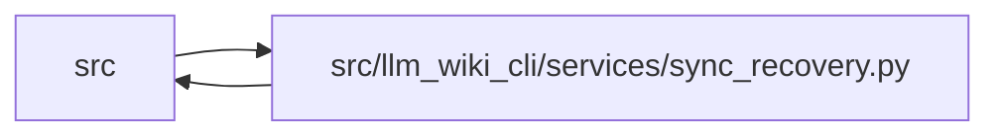

# sync_recovery Module

**Path:** `src/llm_wiki_cli/services/sync_recovery.py`

## Description

Explicit recovery of unchanged new Markdown pages from a rejected sync.

The owning sync observes Markdown writes that had neither a physical preimage
nor a committed outgoing owner. Before each new write it retains the intended
bytes outside the wiki; completion binds the actual file identity to those
bytes. A rejected operation emits its unique journal directory and exact hash.
Existing source/publication and ownership checks remain mandatory.

`maintenance recover-new-pages` previews or explicitly removes only matching
operation-created pages. It verifies the original wiki identity, committed root
hashes, source-selection commitments, current manifest ownership, page identities
and retained bytes before deletion. Edited or replaced pages and unsafe links
refuse recovery. Native absolute paths identify filesystem inputs; canonical
relative POSIX paths identify wiki pages.

Recovery preserves existing prose, source and committed authority. It does not
validate or restore the whole interrupted snapshot, adopt a wiki or reconstruct
review history. A subsequent owning sync is required. An I/O failure can stop
after partial deletion; all rejected-operation postimages remain available.
Adopted full-snapshot recovery keeps its separate authority contract. Successful
syncs discard only verified private scratch and retain unexpected contents.

## Imports

| Source | Symbols |
|--------|---------|
| `.filesystem_guard` | `atomic_write_guarded_bytes`, `ensure_guarded_directory`, `fresh_no_follow_stat`, `unlink_guarded_bytes` |
| `.io` | `first_unsafe_path_component` |
| `.knowledge_governance` | `_governance_lock_root` |
| `.knowledge_storage` | `canonical_bytes`, `digest` |
| `.knowledge_storage_io` | `_absolute_path`, `_identity`, `read_guarded` |
| `.maintenance_protocol` | `governance_writer_lock`, `storage_writer_lock` |
| `.request_json` | `_pairs`, `_constant` |
| `.source_snapshot` | `SourceSnapshot` |
| `.sync_manifest` | `SyncManifest` |
| `.wiki_write_basis` | `ACTIVE_SYNC_JOURNAL` |
| `__future__` | `annotations` |
| `contextlib` | `contextmanager` |
| `dataclasses` | `dataclass`, `field` |
| `json` | `json` |
| `pathlib` | `Path`, `PurePosixPath` |
| `re` | `re` |
| `sys` | `sys` |
| `tempfile` | `tempfile` |
| `typing` | `Any` |
| `uuid` | `UUID`, `uuid4` |

## Local dependency map

<!-- Auto-generated local dependency summary. Do not edit by hand. -->

> Module-level dependencies exceed the generated-diagram limits, so the diagram and table below group them by top-level package. Counts report the number of module neighbors in each package.

### Internal neighbors

| Direction | Module |
|---|---|
| Inbound | `src` (2) |
| Outbound | `src` (10) |

> All 12 module neighbor(s) are summarized by package because the module-level view exceeds the 12-node limit.

## Classes

| Class | Line | Bases | Description |
|-------|------|-------|-------------|
| [SyncRecoveryError](../entities/SyncRecoveryError.md) | 42 | `ValueError` | A recovery proof or operation cannot be admitted safely. |
| [NewPageJournal](../entities/NewPageJournal.md) | 138 | — | — |

## Functions

| Function | Signature | Decorators | Description |
|----------|-----------|------------|-------------|
| `_safe` | `(path: Path) -> None` | — | — |
| `_page` | `(name: str) -> str` | — | — |
| `_authority` | `(root: Path)` | — | — |
| `_anchors` | `(root: Path) -> dict[str, str \| None]` | — | — |
| `_root_identity` | `(root: Path) -> list[int]` | — | — |
| `_policy_inputs` | `(snapshot: SourceSnapshot) -> dict[str, str \| None]` | — | — |
| `_owned_pages` | `(manifest) -> set[str]` | — | Missing pages with committed outgoing owners are never new-page writes. |
| `capture_new_sync_pages` | `(wiki_dir, snapshot, manifest = None)` | `@contextmanager` | Retain rejected writes; never repair them implicitly. |
| `recover_new_sync_pages` | `(wiki_dir, *, recovery_dir, expected_journal_hash, dry_run = False)` | — | Remove only unchanged transaction-created pages, preserving postimages. |