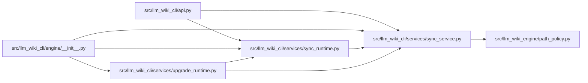

# sync_service Module

**Path:** `src/llm_wiki_cli/services/sync_service.py`

## Description

Typed sync inputs and results shared by the CLI, the Python API and engines.

Importing this module is cheap; the sync implementation lives in
:mod:`llm_wiki_cli.services.sync_runtime` and is loaded on first use.

## Imports

| Source | Symbols |
|--------|---------|
| `__future__` | `annotations` |
| `collections.abc` | `Iterable`, `Mapping` |
| `dataclasses` | `dataclass`, `field` |
| `llm_wiki_engine.path_policy` | `DEFAULT_WIKI_DIR` |
| `pathlib` | `Path` |
| `typing` | `Any`, `Literal` |

## Local dependency map

<!-- Auto-generated local dependency summary. Do not edit by hand. -->

### Internal neighbors

| Direction | Module |
|---|---|
| Inbound | [api](../modules/api.md) |
| Inbound | [engine___init__](../modules/engine___init__.md) |
| Inbound | [sync_runtime](../modules/sync_runtime.md) |
| Inbound | [upgrade_runtime](../modules/upgrade_runtime.md) |
| Outbound | [path_policy](../modules/path_policy.md) |

## Classes

| Class | Kind | Line | Bases / Target | Description |
|-------|------|------|----------------|-------------|
| [SyncStatus](../entities/SyncStatus.md) | Type alias | 19 | `Literal['synced', 'up-to-date', 'no-change']` | — |
| [SyncRequest](../entities/sync_service_SyncRequest.md) | Class | 23 | — | One incremental sync of ``wiki_root`` from ``source_root``. |
| [SyncOutcome](../entities/SyncOutcome.md) | Class | 59 | — | What one sync did; human-readable progress went to the host streams. |
| [SyncError](../entities/SyncError.md) | Class | 78 | `Exception` | Sync stopped; ``exit_code`` is the status the CLI would exit with. |
| [SyncRequestError](../entities/SyncRequestError.md) | Class | 86 | `SyncError` | The request's options are invalid or contradict each other. |
