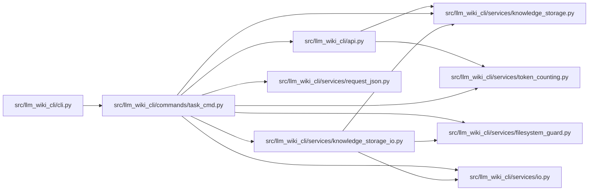

# task_cmd Module

**Path:** `src/llm_wiki_cli/commands/task_cmd.py`

## Description

Adapts explicit task requests and optional profiles to canonical task context. Workspace roots, counter configuration and full-inventory permission are operator options. A response that cannot fit emits no partial context, and read proposals remain data for the host to consider.

## Imports

| Source | Symbols |
|--------|---------|
| `..` | `api` |
| `..services.filesystem_guard` | `atomic_write_guarded_bytes`, `ensure_guarded_directory` |
| `..services.io` | `write_text_output`, `write_utf8_stdout`, `first_unsafe_path_component` |
| `..services.knowledge_storage` | `KnowledgeStorageError` |
| `..services.knowledge_storage_io` | `read_guarded` |
| `..services.request_json` | `load_request` |
| `..services.token_counting` | `LocalTokenizerCounter` |
| `json` | `json` |
| `pathlib` | `Path` |
| `stat` | `stat` |
| `sys` | `sys` |

## Local dependency map

<!-- Auto-generated local dependency summary. Do not edit by hand. -->

### Internal neighbors

| Direction | Module |
|---|---|
| Inbound | [cli](../modules/cli.md) |
| Outbound | [api](../modules/api.md) |
| Outbound | [filesystem_guard](../modules/filesystem_guard.md) |
| Outbound | [io](../modules/io.md) |
| Outbound | [knowledge_storage](../modules/knowledge_storage.md) |
| Outbound | [knowledge_storage_io](../modules/knowledge_storage_io.md) |
| Outbound | [request_json](../modules/request_json.md) |
| Outbound | [token_counting](../modules/token_counting.md) |

## Functions

| Function | Signature | Decorators | Description |
|----------|-----------|------------|-------------|
| `_safe_absolute` | `(value)` | — | — |
| `_parent_stamps` | `(path)` | — | — |
| `_compact_outputs` | `(args)` | — | Pin explicit artifact destinations before any workspace capture. |
| `_publish_compact_outputs` | `(outputs, result)` | — | — |
| `run` | `(args)` | — | — |