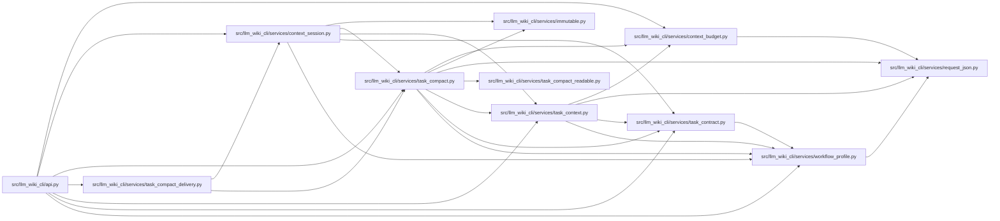

# task_compact Module

**Path:** `src/llm_wiki_cli/services/task_compact.py`

## Description

Pure, canonical-bound task presentation with separately counted view budgets.

View request v1 selects the encoded compact-v1 projection. View request v2
selects [readable selected evidence](task_compact_readable.md) with full fact
objects and canonical limitations, requiring no observation codec/codebook.
Both validate original canonical evidence and retain exact request/profile,
counter, budget and view identity binding. A budget failure emits a separately
counted diagnostic and preserves the available canonical receipt. Presentation
performs no source reads; delivery uses the owned task/session lifecycle.

## Imports

| Source | Symbols |
|--------|---------|
| `.context_budget` | `_accounted_render` |
| `.immutable` | `freeze` |
| `.request_json` | `_pairs`, `_constant` |
| `.task_compact_readable` | `readable_projection`, `readable_expansion` |
| `.task_context` | `validate_task_context`, `_counter`, `_LIMITATIONS` |
| `.task_contract` | `TaskContext`, `TASK_REQUEST_SCHEMA_V2`, `normalize_task_request` |
| `.workflow_profile` | `canonical_json`, `content_id` |
| `__future__` | `annotations` |
| `collections.abc` | `Mapping` |
| `copy` | `deepcopy` |
| `dataclasses` | `dataclass` |
| `json` | `json` |
| `typing` | `Any` |

## Local dependency map

<!-- Auto-generated local dependency summary. Do not edit by hand. -->

### Internal neighbors

| Direction | Module |
|---|---|
| Inbound | [api](../modules/api.md) |
| Inbound | [context_session](../modules/context_session.md) |
| Inbound | [task_compact_delivery](../modules/task_compact_delivery.md) |
| Outbound | [context_budget](../modules/context_budget.md) |
| Outbound | [immutable](../modules/immutable.md) |
| Outbound | [request_json](../modules/request_json.md) |
| Outbound | [task_compact_readable](../modules/task_compact_readable.md) |
| Outbound | [task_context](../modules/task_context.md) |
| Outbound | [task_contract](../modules/task_contract.md) |
| Outbound | [workflow_profile](../modules/workflow_profile.md) |

## Classes

| Class | Line | Bases | Description |
|-------|------|-------|-------------|
| [TaskCompactError](../entities/TaskCompactError.md) | 78 | `ValueError` | — |
| [CompactTaskContext](../entities/CompactTaskContext.md) | 85 | — | — |
| [_CheckedCounter](../entities/CheckedCounter.md) | 142 | — | — |

## Functions

| Function | Signature | Decorators | Description |
|----------|-----------|------------|-------------|
| `_encode_limits` | `(values)` | — | — |
| `_decode_limits` | `(values)` | — | — |
| `normalize_view_options` | `(value, *, ceiling)` | — | — |
| `_validated` | `(canonical_text, request, profile, policy, counter)` | — | — |
| `_same` | `(first, second)` | — | — |
| `_encode_contract` | `(value)` | — | Only explicit, present known defaults can use a reversible codec. |
| `_decode_contract` | `(value)` | — | — |
| `_encode_observation` | `(facet, value)` | — | — |
| `_decode_observation` | `(value)` | — | — |
| `_projection` | `(canonical, request)` | — | — |
| `_expanded` | `(payload)` | — | — |
| `render_compact_task_context` | `(canonical_text, request, *, view_options, profile = None, policy = None, counter = None)` | — | — |
| `validate_compact_task_context` | `(compact_text, canonical_text, request, *, view_options, profile = None, policy = None, counter = None)` | — | — |
| `expand_compact_task_context` | `(compact_text, canonical_text, request, *, view_options, profile = None, policy = None, counter = None)` | — | — |