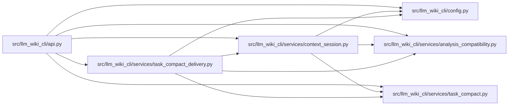

# task_compact_delivery Module

**Path:** `src/llm_wiki_cli/services/task_compact_delivery.py`

## Description

One-shot compact delivery through the owned, locked task read lifecycle.

## Imports

| Source | Symbols |
|--------|---------|
| `.` | `analysis_compatibility` |
| `..config` | `DEFAULT_WIKI_DIR` |
| `.context_session` | `ContextSession` |
| `.task_compact` | `CompactTaskContext` |
| `__future__` | `annotations` |

## Local dependency map

<!-- Auto-generated local dependency summary. Do not edit by hand. -->

### Internal neighbors

| Direction | Module |
|---|---|
| Inbound | [api](../modules/api.md) |
| Outbound | [config](../modules/config.md) |
| Outbound | [analysis_compatibility](../modules/analysis_compatibility.md) |
| Outbound | [context_session](../modules/context_session.md) |
| Outbound | [task_compact](../modules/task_compact.md) |

## Functions

| Function | Signature | Decorators | Description |
|----------|-----------|------------|-------------|
| `build_compact_task_context` | `(request, *, view_options = None, src_dir = '.', wiki_dir = DEFAULT_WIKI_DIR, profile = None, policy = None, counter = None, allow_external_src = False, source_selection = None, helper_cache_dir = None, cancelled = None) -> CompactTaskContext` | `@ac.bound_comparison` | Return a complete current view and its exact separately budgeted receipt. |
