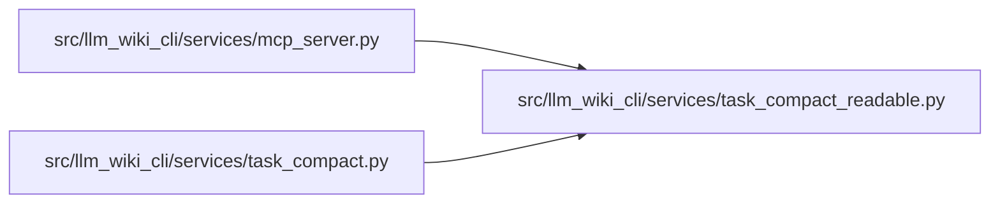

# task_compact_readable Module

**Path:** `src/llm_wiki_cli/services/task_compact_readable.py`

## Description

Projects compact-v2 task evidence as readable JSON with complete selected facts,
citations, coverage, qualifications, gaps and limitations. Canonical validation
and the full host-owned receipt remain authoritative; the view contains their
identities and selected evidence, while raw capture/work data stays in the
receipt. The view budget covers emitted body text, including its accounting.

MCP uses `readable_session_metadata` to omit only work/reuse telemetry and
derivable size counters from the default v2 envelope. Identity, conditional
base, validation qualifications, limitations and future metadata fields remain.
Callers can request full metadata with `include_metadata: true`; Python session
metadata remains complete. Host framing and required follow-ups have separate
costs. Compact-v1 retains its encoded projection and envelope.

## Imports

| Source | Symbols |
|--------|---------|
| `copy` | `deepcopy` |

## Local dependency map

<!-- Auto-generated local dependency summary. Do not edit by hand. -->

### Internal neighbors

| Direction | Module |
|---|---|
| Inbound | [mcp_server](../modules/mcp_server.md) |
| Inbound | [task_compact](../modules/task_compact.md) |

## Functions

| Function | Signature | Decorators | Description |
|----------|-----------|------------|-------------|
| `readable_projection` | `(canonical, request)` | — | Preserve full selected evidence; authoritative capture stays host-owned. |
| `readable_expansion` | `(payload)` | — | — |
| `readable_session_metadata` | `(metadata)` | — | Keep delivery identity/currentness qualifications; telemetry is opt-in. |