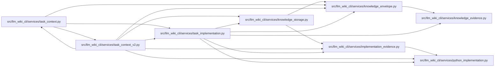

# task_implementation Module

**Path:** `src/llm_wiki_cli/services/task_implementation.py`

## Description

Bind optional task implementation comparisons to their captured inputs.

## Imports

| Source | Symbols |
|--------|---------|
| `.implementation_evidence` | `validate_implementation_evidence`, `validate_implementation_comparison` |
| `.knowledge_envelope` | `ConsumedInput`, `hash_source_snapshot` |
| `.knowledge_evidence` | `is_valid_sha256` |
| `.knowledge_storage` | `canonical_bytes`, `digest`, `canonical_bytes`, `digest` |
| `.python_implementation` | `analysis_identity` |
| `__future__` | `annotations` |
| `collections.abc` | `Mapping` |

## Local dependency map

<!-- Auto-generated local dependency summary. Do not edit by hand. -->

### Internal neighbors

| Direction | Module |
|---|---|
| Inbound | [task_context](../modules/task_context.md) |
| Inbound | [task_context_v2](../modules/task_context_v2.md) |
| Outbound | [implementation_evidence](../modules/implementation_evidence.md) |
| Outbound | [knowledge_envelope](../modules/knowledge_envelope.md) |
| Outbound | [knowledge_evidence](../modules/knowledge_evidence.md) |
| Outbound | [knowledge_storage](../modules/knowledge_storage.md) |
| Outbound | [python_implementation](../modules/python_implementation.md) |

## Functions

| Function | Signature | Decorators | Description |
|----------|-----------|------------|-------------|
| `native_bindings` | `(concepts)` | — | Extract owner bindings from consumed native records, never display names. |
| `attach_bindings` | `(body, bindings)` | — | — |
| `capture_receipt` | `(inventory_result)` | — | — |
| `_comparisons` | `(fact)` | — | — |
| `attach_capture` | `(body, inventory_result)` | — | — |
| `validate_task_implementations` | `(payload, settings)` | — | — |
